# Diagram 1: Complete EventFlow AI System Architecture

## Purpose
This diagram presents the complete high-level system architecture of **EventFlow AI**, depicting the ingress boundaries, core processing engines, persistence tiers, dual message brokers, analytical stores, and AI-assisted operational intelligence.

---

## Architecture Diagram

```mermaid
flowchart TD
    %% Styling and Classes
    classDef clientStyle fill:#e0f2fe,stroke:#0284c7,stroke-width:2px,color:#0369a1;
    classDef apiStyle fill:#fef3c7,stroke:#d97706,stroke-width:2px,color:#b45309;
    classDef dbStyle fill:#ecfdf5,stroke:#059669,stroke-width:2px,color:#047857;
    classDef brokerStyle fill:#ede9fe,stroke:#7c3aed,stroke-width:2px,color:#6d28d9;
    classDef workerStyle fill:#fae8ff,stroke:#c026d3,stroke-width:2px,color:#a21caf;
    classDef olapStyle fill:#f0fdf4,stroke:#16a34a,stroke-width:2px,color:#15803d;
    classDef aiStyle fill:#fff1f2,stroke:#e11d48,stroke-width:2px,color:#be123c;
    classDef obsStyle fill:#f1f5f9,stroke:#475569,stroke-width:2px,color:#334155;

    subgraph Tier0["Layer 1: Ingress & Clients"]
        ExternalClient["External Client / Microservice<br/>(HTTP Event Producer)"]:::clientStyle
        OperatorBrowser["Operator / Admin<br/>(React 19 SPA)"]:::clientStyle
    end

    subgraph Tier1["Layer 2: Django REST Framework API Gateway"]
        AuthLayer["Authentication & Scope<br/>(SessionAuth & APIClientAuth)"]:::apiStyle
        EventIngestAPI["Event Ingest Controller<br/>POST /api/v1/events"]:::apiStyle
        WorkflowAPI["Workflow & Command API<br/>/api/v1/workflows"]:::apiStyle
        IncidentAPI["AI Incident API<br/>/api/v1/incidents/summary"]:::apiStyle
        AnalyticsAPI["Analytics Controller<br/>/api/v1/analytics/*"]:::apiStyle
        HealthMetricsAPI["Health & Prometheus Exporter<br/>/health & /metrics"]:::apiStyle
    end

    subgraph Tier2["Layer 3: Relational OLTP Persistence (PostgreSQL 16)"]
        direction TB
        PostgresTx["Single ACID Transaction Scope"]:::dbStyle
        EventsTable[("events<br/>(Immutable Log)")]:::dbStyle
        WorkflowsTable[("workflows & attempts<br/>(Saga State Machine)")]:::dbStyle
        OutboxTable[("outbox_messages<br/>(Transactional Queue)")]:::dbStyle
        CommerceTable[("orders, inventory, payments<br/>(Domain State)")]:::dbStyle
        IncidentTable[("incident_summaries<br/>(AI Explanations)")]:::dbStyle
        AuthTable[("api_clients & auth_user<br/>(Security Entities)")]:::dbStyle
    end

    subgraph Tier3["Layer 4: Transactional Outbox Relay"]
        OutboxPublisher["Outbox Publisher Worker<br/>(SELECT ... FOR UPDATE SKIP LOCKED)"]:::workerStyle
    end

    subgraph Tier4["Layer 5: Distributed Event Streaming (Apache Kafka)"]
        DomainTopic{{"Topic: eventflow.domain.events.v1<br/>(Partitions: 3)"}}:::brokerStyle
        LifecycleTopic{{"Topic: eventflow.workflow.lifecycle.v1<br/>(Partitions: 3)"}}:::brokerStyle
    end

    subgraph Tier5["Layer 6: Bridge & Task Brokerage (RabbitMQ 4.2)"]
        KafkaConsumer["Kafka-to-Rabbit Bridge Consumer<br/>Group: eventflow.kafka-to-rabbit.v1"]:::workerStyle
        TaskExchange[["Direct Exchange: eventflow.tasks.x"]]:::brokerStyle
        TaskQueue["Task Queue: eventflow.tasks.workflow.q"]:::brokerStyle
        RetryExchange[["Retry Exchange: eventflow.retry.x"]]:::brokerStyle
        RetryQueues["TTL Delay Queues:<br/>retry.5s (5s) | retry.30s (30s)"]:::brokerStyle
        DeadExchange[["Dead Exchange: eventflow.dead.x"]]:::brokerStyle
        DeadQueue["Dead-Letter Queue:<br/>eventflow.tasks.dead.q"]:::brokerStyle
    end

    subgraph Tier6["Layer 7: Workflow Saga Execution"]
        WorkflowWorker["Workflow Saga Worker<br/>(Stage Handlers & Compensations)"]:::workerStyle
    end

    subgraph Tier7["Layer 8: Analytical OLAP Engine (ClickHouse 25.12)"]
        AnalyticsConsumer["Analytics Consumer Worker<br/>Group: eventflow.clickhouse-analytics.v1"]:::workerStyle
        ClickHouseTable[("workflow_lifecycle_facts<br/>(ReplacingMergeTree Engine)")]:::olapStyle
    end

    subgraph Tier8["Layer 9: AI Operational Intelligence Engine"]
        IncidentService["Incident Investigation Engine<br/>(apps/incidents/service.py)"]:::aiStyle
        Sanitizer["PII & Credential Redactor<br/>(apps/incidents/evidence.py)"]:::aiStyle
        LLMProvider["LLM Provider Adapter<br/>(Gemini 3.8 Flash / OpenAI / Mock)"]:::aiStyle
    end

    subgraph Tier9["Layer 10: Observability & Telemetry"]
        PrometheusMetrics["Prometheus Exporter (Port 9100)<br/>Worker & API Metrics"]:::obsStyle
    end

    %% Ingress Flows
    ExternalClient -->|"1. POST Bearer Token + JSON Envelope"| EventIngestAPI
    OperatorBrowser -->|"1. HTTPS Cookie Session"| AuthLayer
    OperatorBrowser -->|"Query & Trigger Actions"| WorkflowAPI
    OperatorBrowser -->|"Request Analysis"| IncidentAPI
    OperatorBrowser -->|"Query Metrics & KPIs"| AnalyticsAPI

    %% API to Database
    AuthLayer -.->|"Validate Credentials"| AuthTable
    EventIngestAPI -->|"2. Atomic Batch Insert"| PostgresTx
    PostgresTx --- EventsTable
    PostgresTx --- WorkflowsTable
    PostgresTx --- OutboxTable

    %% Outbox to Kafka
    OutboxTable -->|"3. Lease Ready Rows"| OutboxPublisher
    OutboxPublisher -->|"4. Publish Key=event_id"| DomainTopic
    OutboxPublisher -->|"Publish Key=workflow_id"| LifecycleTopic

    %% Kafka to RabbitMQ Bridge
    DomainTopic -->|"5. Consume Batch"| KafkaConsumer
    KafkaConsumer -->|"6. Publish Task"| TaskExchange
    TaskExchange -->|"Route workflow.stage.v1"| TaskQueue
    KafkaConsumer -.->|"Commit Offset (Only After Rabbit Confirmed)"| DomainTopic

    %% Task Queue to Workflow Worker
    TaskQueue -->|"7. Deliver Task"| WorkflowWorker
    WorkflowWorker -->|"8. Stage Execution & State Updates"| WorkflowsTable
    WorkflowWorker -->|"Domain Mutex & Stock Updates"| CommerceTable
    WorkflowWorker -->|"Stage Lifecycle Event"| OutboxTable

    %% Retry & DLQ Flow
    WorkflowWorker -->|"On Transient Error (Retry)"| RetryExchange
    RetryExchange --> RetryQueues
    RetryQueues -->|"Dead-Letter On TTL Expiration"| TaskExchange
    WorkflowWorker -->|"On Permanent Error / Limit Exhausted"| DeadExchange
    DeadExchange --> DeadQueue

    %% Analytics Pipeline
    LifecycleTopic -->|"Stream Events"| AnalyticsConsumer
    AnalyticsConsumer -->|"Batch Insert Idempotent Facts"| ClickHouseTable
    AnalyticsAPI -->|"Query P50/P95/P99 & Throughput"| ClickHouseTable
    AnalyticsAPI -->|"Query Tenant Scoped Aggregates"| WorkflowsTable

    %% AI Pipeline
    IncidentAPI -->|"Initiate Investigation"| IncidentService
    IncidentService -->|"Collect Attempts & Logs"| WorkflowsTable
    IncidentService -->|"Redact Secrets & PII"| Sanitizer
    Sanitizer -->|"Structured Grounded Prompt"| LLMProvider
    LLMProvider -->|"Validated Structured JSON"| IncidentService
    IncidentService -->|"Store Evidence & Summary"| IncidentTable

    %% Metrics
    WorkflowWorker -.-> PrometheusMetrics
    OutboxPublisher -.-> PrometheusMetrics
    KafkaConsumer -.-> PrometheusMetrics
    AnalyticsConsumer -.-> PrometheusMetrics
```

---

## Component Breakdown

| Layer | Component | Implementation File / Container | Responsibility |
| :--- | :--- | :--- | :--- |
| **Layer 1** | External Client | External Systems / Python SDK | Emits signed domain events with idempotency keys. |
| | Frontend Dashboard | `frontend/` (React 19 / Vite) | Real-time workspace monitor, saga explorer, commerce catalog, and incident viewer. |
| **Layer 2** | API Gateway | `api` service (Django 5.1 / Gunicorn) | Dual auth (Bearer + Session), JSON contract enforcement, and REST controllers. |
| **Layer 3** | PostgreSQL OLTP | `db` service (`postgres:16.6-bookworm`) | ACID state store for events, sagas, commerce inventory, and transactional outbox. |
| **Layer 4** | Outbox Publisher | `outbox-publisher` (`publish_outbox.py`) | Background loop leasing unpublished rows via `SKIP LOCKED` and publishing to Kafka. |
| **Layer 5** | Apache Kafka | `kafka` service (`apache/kafka:4.3.2` KRaft) | Durable, ordered, partitioned streaming log for domain events and lifecycle facts. |
| **Layer 6** | Kafka-to-Rabbit Bridge | `kafka-consumer` (`consume_domain_events.py`) | Consumes Kafka domain events and enqueues durable tasks to RabbitMQ with offset commits. |
| | RabbitMQ Broker | `rabbitmq` service (`rabbitmq:4.2-management`) | Work-distribution queue broker with exchange-based delayed retries and DLQ routing. |
| **Layer 7** | Workflow Saga Worker | `workflow-worker` (`process_workflows.py`) | Executes forward saga stages, tracks state transitions, and invokes backward compensation. |
| **Layer 8** | ClickHouse OLAP | `clickhouse` service (`clickhouse/clickhouse-server:25.12`) | High-speed analytical engine calculating latencies, throughput, and error distributions. |
| | Analytics Consumer | `analytics-consumer` (`consume_lifecycle_analytics.py`) | Consumes Kafka lifecycle events and writes to ClickHouse `workflow_lifecycle_facts`. |
| **Layer 9** | AI Intelligence | `apps/incidents/service.py` | Extracts workflow evidence, scrubs PII, queries LLMs, and stores structured root-cause reports. |
| **Layer 10** | Observability | Prometheus Exporter (Port 9100) | Multi-process Prometheus metrics server tracking latencies, retries, and queue depths. |

---

## Data Flow Summary

1. **Ingestion**: External clients POST events to `/api/v1/events`. Authentication validates the client's bearer token. An ACID transaction atomically writes `Event`, `Workflow`, `ProcessingLog`, and `OutboxMessage`.
2. **Streaming**: `outbox-publisher` leases rows using PostgreSQL `SKIP LOCKED`, publishes messages to Kafka topic `eventflow.domain.events.v1`, and marks rows published.
3. **Bridge & Queue**: `kafka-consumer` reads the Kafka domain topic, transforms the message into a workflow task, and publishes it to RabbitMQ exchange `eventflow.tasks.x`. It commits the Kafka offset only after RabbitMQ confirms receipt.
4. **Execution**: `workflow-worker` pulls tasks from RabbitMQ queue `eventflow.tasks.workflow.q`, executes discrete stage handlers (e.g. reserve inventory, authorize payment), writes updates to PostgreSQL, and pushes lifecycle facts to the outbox.
5. **Retries & DLQ**: On transient errors, tasks route to RabbitMQ TTL queues (`retry.5s` / `retry.30s`). On permanent failure, completed stages are compensated and the task is moved to `eventflow.tasks.dead.q`.
6. **Analytics**: Outbox messages on `eventflow.workflow.lifecycle.v1` are read by `analytics-consumer` and batch-inserted into ClickHouse for real-time aggregation.
7. **AI Investigation**: When an incident is inspected, `IncidentService` aggregates evidence from PostgreSQL, redacts PII, queries Gemini/OpenAI, and stores a deterministic incident explanation.

---

## Reliability & Security Considerations

- **Dual-Write Elimination**: The API does not communicate directly with Kafka or RabbitMQ during HTTP requests; failure to reach external brokers never rolls back a valid client transaction.
- **At-Least-Once Delivery**: Both Kafka consumers and RabbitMQ workers acknowledge messages only after downstream persistence is confirmed. Downstream stage handlers are idempotent.
- **Zero-Trust AI Guardrails**: The LLM engine has read-only access to bounded, redacted evidence snapshots. AI outputs cannot alter workflow states, trigger payments, or manipulate queues.

---

## Implementation Status
- **Status**: Implemented and Verified in Local & Docker Compose Environments.
- **Source Paths**:
  - API & URL Routing: [`config/urls.py`](file:///d:/eventflow-ai/config/urls.py), [`apps/events/`](file:///d:/eventflow-ai/apps/events/)
  - Outbox & Workers: [`apps/processing/`](file:///d:/eventflow-ai/apps/processing/)
  - Saga Engine: [`apps/processing/saga/`](file:///d:/eventflow-ai/apps/processing/saga/)
  - Analytics & ClickHouse: [`apps/analytics/`](file:///d:/eventflow-ai/apps/analytics/)
  - AI Incident Service: [`apps/incidents/`](file:///d:/eventflow-ai/apps/incidents/)

