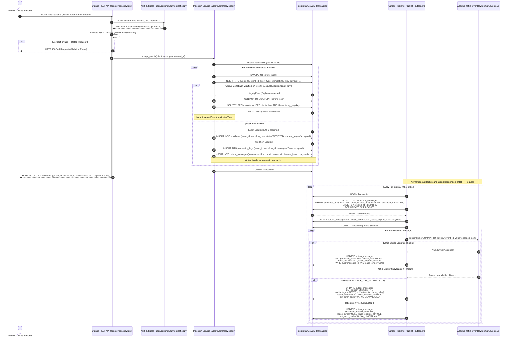

# Diagram 2: Event Ingestion and Transactional Outbox

## Purpose
This document details the exact sequence and failure mechanics of the **Event Ingestion and Transactional Outbox** pattern implemented in EventFlow AI. It illustrates how the platform achieves atomic database persistence and asynchronous event publication without dual-write hazards.

---

## Ingestion & Outbox Sequence Diagram



---

## Detailed Component Responsibilities

### 1. Ingestion Endpoint (`apps/events/views.py` & `apps/events/services.py`)
- Receives HTTP payload matching `EventBatchSerializer` (`event_type`, `schema_version`, `source`, `idempotency_key`, `occurred_at`, `correlation_id`, `payload`).
- Generates a unique `request_id` for end-to-end distributed tracing.
- Executes `accept_events()` inside a PostgreSQL transaction (`@transaction.atomic`).

### 2. Savepoint Idempotency Mechanism
- To handle concurrent duplicate requests safely, `apps/events/services.py` wraps each item insert in a sub-transaction savepoint:
  ```python
  with transaction.atomic():
      event = Event.objects.create(...)
      workflow = Workflow.objects.create(...)
      record_initial_domain_outbox(event, workflow_id=workflow.id)
      ProcessingLog.objects.create(...)
  ```
- If an `IntegrityError` is triggered by PostgreSQL's `event_client_source_idem_uniq` constraint (`UniqueConstraint(fields=["client", "source", "idempotency_key"])`), only the savepoint rolls back. The transaction queries the previously created event and returns `AcceptedEvent(duplicate=True)` without failing the entire batch.

### 3. Outbox Row Invariant (`apps/processing/models.py`)
- The `OutboxMessage` record is written to PostgreSQL **in the exact same ACID transaction** as the `Event` and `Workflow`.
- Fields include:
  - `dedupe_key`: e.g. `event:<uuid>:domain.v1`
  - `topic`: `eventflow.domain.events.v1`
  - `payload`: Normalized JSON contract
  - `available_at`: Earliest timestamp when this message can be claimed
  - `lease_owner` & `lease_expires_at`: Worker claim lock
  - `published_at` & `dead_lettered_at`: Terminal outbox states

### 4. Competing Consumer Worker Leasing (`apps/processing/outbox.py`)
- To allow multiple `outbox-publisher` instances to run concurrently without publishing duplicate messages or encountering race conditions, rows are claimed using PostgreSQL's `SKIP LOCKED`:
  ```python
  OutboxMessage.objects.select_for_update(skip_locked=True).filter(
      published_at__isnull=True,
      dead_lettered_at__isnull=True,
      available_at__lte=now,
      lease_expires_at__isnull=True | lease_expires_at__lte=now
  ).order_by("created_at", "id")[:batch_size]
  ```
- Claimed rows receive a 60-second lease (`OUTBOX_LEASE_SECONDS = 60`). If a publisher container crashes mid-publish, the lease expires and another instance reclaims the row.

---

## Why the Transactional Outbox Eliminates the Dual-Write Problem

### The Dual-Write Hazard (Direct Broker Publishing)
In naive architectures, the API controller inserts records into the database and immediately calls `kafka_producer.send()`:
1. If the database commit succeeds but Kafka is unreachable, the event is permanently lost to downstream consumers.
2. If Kafka publish succeeds but the database transaction fails to commit (e.g. database disconnect), Kafka processes a "phantom event" that does not exist in the database.

### The EventFlow AI Guarantee
- By writing the outbox row **inside PostgreSQL's transaction**, either **both** the event state and the outbox record commit, or **neither** does.
- External publication is handled asynchronously by `outbox-publisher`.
- Even if Kafka is down for minutes or hours, outbox rows queue safely in PostgreSQL. Once Kafka recovers, the publisher resumes seamlessly.

---

## Reliability & Delivery Guarantees

| Guarantee | Level | Mechanism |
| :--- | :--- | :--- |
| **Ingestion Atomicity** | **Strict ACID** | All 4 entities (`Event`, `Workflow`, `Log`, `Outbox`) commit atomically in PostgreSQL. |
| **Ingestion Idempotency** | **Deduplicated** | `(client, source, idempotency_key)` database unique constraint returns existing records on replay. |
| **Publishing Delivery** | **At-Least-Once** | Messages are committed as published only after Kafka acknowledges receipt. Crash between publish and update results in safe replay downstream. |
| **Exponential Backoff** | **Bounded Retries** | Failures back off with $2^{\text{attempts}} \times \text{base\_delay}$, capped at 12 attempts before dead-lettering. |

---

## Implementation Status
- **Status**: Implemented and Verified.
- **Source Paths**:
  - Ingestion Logic: [`apps/events/services.py`](file:///d:/eventflow-ai/apps/events/services.py)
  - Models: [`apps/events/models.py`](file:///d:/eventflow-ai/apps/events/models.py), [`apps/processing/models.py`](file:///d:/eventflow-ai/apps/processing/models.py)
  - Outbox Management: [`apps/processing/outbox.py`](file:///d:/eventflow-ai/apps/processing/outbox.py)
  - Publisher Command: [`apps/processing/management/commands/publish_outbox.py`](file:///d:/eventflow-ai/apps/processing/management/commands/publish_outbox.py)

