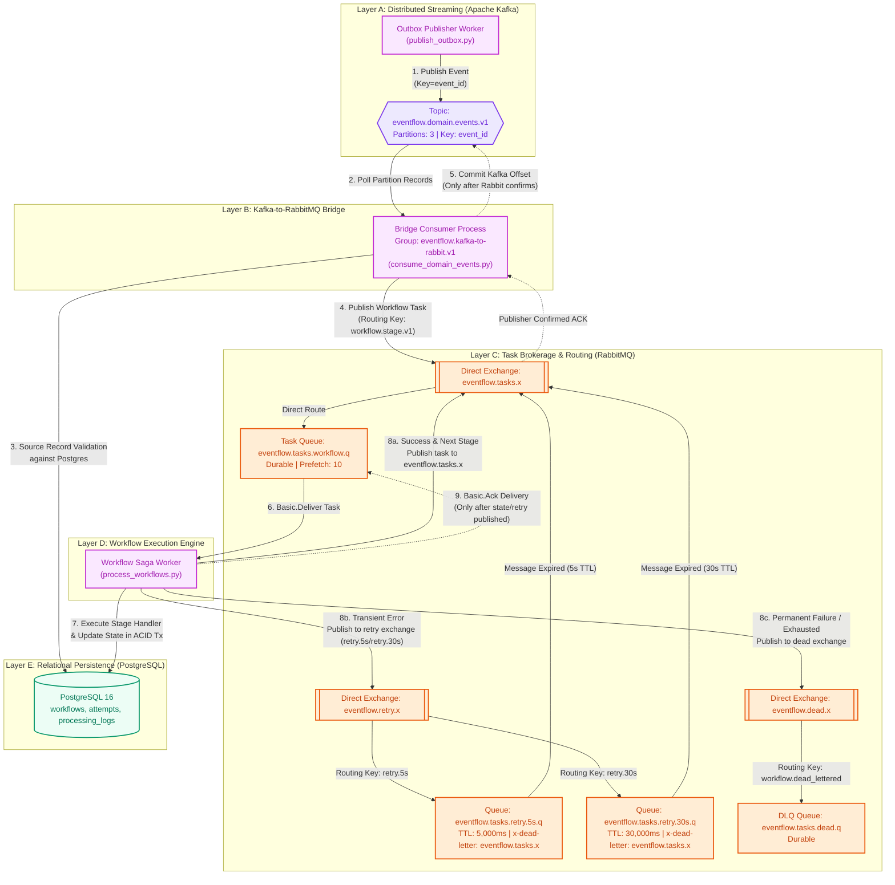

# Diagram 3: Kafka to RabbitMQ Processing Pipeline

## Purpose
This document explains the messaging architecture and service interactions between **Apache Kafka** and **RabbitMQ** in EventFlow AI. It details why both message systems are utilized, how the bridge consumer guarantees message delivery without loss, and where at-least-once semantics occur.

---

## Dual-Broker Pipeline Diagram



---

## Why Both Kafka and RabbitMQ?

A common question in distributed architecture interviews is: *Why use both Kafka and RabbitMQ in the same architecture?*

EventFlow AI pairs them deliberately based on their orthogonal strengths:

| Architectural Requirement | Apache Kafka | RabbitMQ | How EventFlow AI Uses It |
| :--- | :--- | :--- | :--- |
| **Data Model** | Distributed partitioned commit log | Smart message broker / dumb consumer | Kafka retains immutable event history; RabbitMQ distributes tasks to workers. |
| **Consumption Semantics** | Partition-ordered reading by offset | Point-to-point work queues with `Basic.Ack` | Kafka streams domain and lifecycle events; RabbitMQ load-balances individual stage tasks across workers. |
| **Retries & Delays** | Difficult (blocks partition head-of-line) | Native support via Dead-Letter Exchanges and TTL queues | Failed stages route to RabbitMQ TTL queues (`retry.5s`, `retry.30s`) without stalling unrelated workflows. |
| **Retention** | Long-term log retention & replay | Ephemeral; deleted immediately upon `ack` | Kafka enables full system event replay and analytics projection; RabbitMQ maintains lean active queues. |

---

## Detailed Pipeline Stages

### 1. Ingestion to Kafka (`apps/processing/outbox.py`)
- The outbox publisher claims batches of ready rows from PostgreSQL.
- It publishes to Kafka topic `eventflow.domain.events.v1`, partitioned by `key=event_id`.
- This ensures all events relating to the same event ID land on the same Kafka partition in strict temporal order.

### 2. Kafka-to-Rabbit Bridge (`apps/processing/pipeline.py` & `consume_domain_events.py`)
- The bridge worker (`ConfluentKafkaConsumer`) subscribes to `eventflow.domain.events.v1` in consumer group `eventflow.kafka-to-rabbit.v1`.
- For each record:
  1. It decodes the payload contract.
  2. It performs a **source verification check** against PostgreSQL to guarantee the `Event` and `Workflow` records exist and match the payload checksum.
  3. It constructs a discrete workflow task envelope:
     ```python
     task = make_workflow_task(event, workflow.id)
     ```
  4. It publishes the task to RabbitMQ exchange `eventflow.tasks.x` with routing key `workflow.stage.v1` using **publisher confirms**.
  5. **Synchronous Commit**: Crucially, `kafka_consumer.commit(record)` is executed **only after RabbitMQ confirms publication**. If RabbitMQ is down, the Kafka offset is not committed, and the message will be reprocessed when the service recovers.

### 3. Task Execution in Workflow Worker (`apps/processing/pipeline.py`)
- `PikaRabbitAdapter` consumes from `eventflow.tasks.workflow.q`.
- When a task arrives:
  1. `process_workflow_task(task)` runs the designated stage handler (e.g. order validation, inventory reservation, payment authorization).
  2. The database updates (`Workflow`, `WorkflowAttempt`, `ProcessingLog`, commerce models) are committed in a PostgreSQL transaction.
  3. Depending on the decision returned:
     - **Next Stage (`ENQUEUE_NEXT`)**: Publishes the next stage task back to `eventflow.tasks.x`.
     - **Transient Retry (`RETRY`)**: Publishes to `eventflow.retry.x` with routing key `retry.5s` or `retry.30s`.
     - **Permanent Dead-Letter (`DEAD_LETTER`)**: Publishes to `eventflow.dead.x` with routing key `workflow.dead_lettered`.
  4. `delivery.ack()` is dispatched to RabbitMQ **only after** all downstream actions and database writes succeed.

---

## At-Least-Once Delivery & Duplicate Processing

> **Important Guarantee Note**: EventFlow AI does **NOT** claim exactly-once processing. It implements **at-least-once delivery with idempotent deduplication**.

### Where duplicates can occur:
1. **Publisher Crash after Kafka Send**: If `outbox-publisher` sends an event to Kafka but crashes before marking `published_at` in PostgreSQL, the row's lease expires and another worker re-publishes it to Kafka.
2. **Bridge Crash after RabbitMQ Publish**: If `kafka-consumer` enqueues a task to RabbitMQ but crashes before committing its Kafka offset, the Kafka partition rebalances and re-delivers the record.
3. **Worker Crash after DB Commit**: If `workflow-worker` completes a stage, updates PostgreSQL, but crashes before sending `delivery.ack()` to RabbitMQ, RabbitMQ re-queues the message upon socket closure.

### How duplicates are handled safely:
- Every entity has natural or synthetic idempotency constraints:
  - Events: Unique constraint on `(client_id, source, idempotency_key)`.
  - Workflow Attempts: Unique constraint on `(workflow_id, stage, direction, attempt_number)`.
  - Inventory Reservations: Checked against existing reservation records.
  - Lifecycle Events: Deduplicated by ClickHouse `ReplacingMergeTree` on `(event_date, workflow_id, event_time, lifecycle_id)`.

---

## Implementation Status
- **Status**: Implemented and Verified in Local & Docker Compose Environments.
- **Source Paths**:
  - Broker Topology Definitions: [`apps/processing/topology.py`](file:///d:/eventflow-ai/apps/processing/topology.py)
  - Pipeline Execution Logic: [`apps/processing/pipeline.py`](file:///d:/eventflow-ai/apps/processing/pipeline.py)
  - Kafka Consumer Command: [`apps/processing/management/commands/consume_domain_events.py`](file:///d:/eventflow-ai/apps/processing/management/commands/consume_domain_events.py)
  - Workflow Worker Command: [`apps/processing/management/commands/process_workflows.py`](file:///d:/eventflow-ai/apps/processing/management/commands/process_workflows.py)
  - Kafka Adapter: [`apps/processing/adapters/kafka.py`](file:///d:/eventflow-ai/apps/processing/adapters/kafka.py)
  - RabbitMQ Adapter: [`apps/processing/adapters/rabbitmq.py`](file:///d:/eventflow-ai/apps/processing/adapters/rabbitmq.py)

