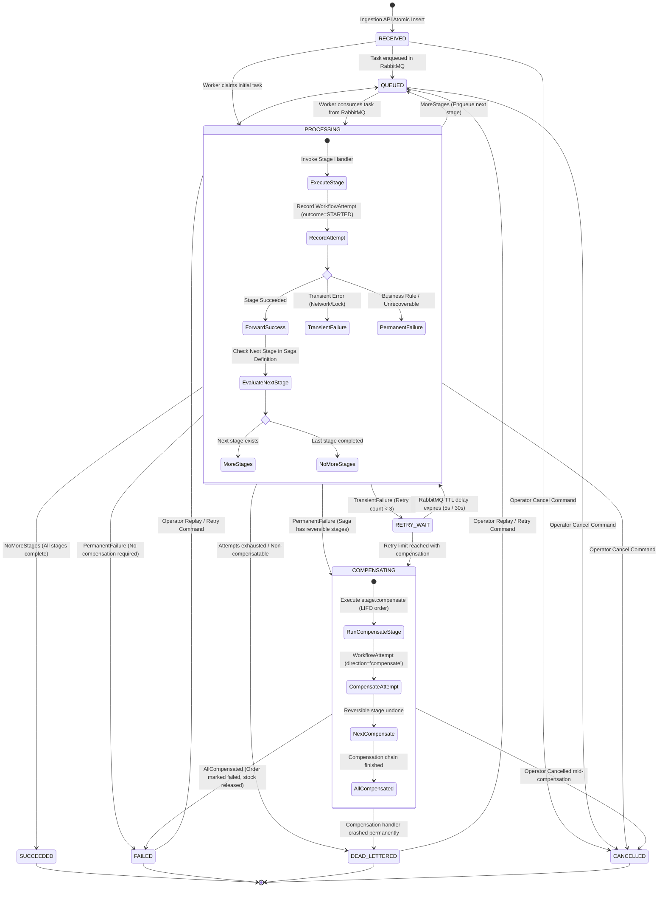
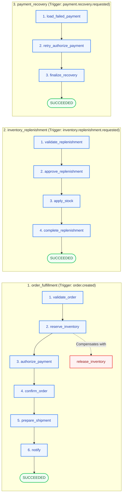

# Diagram 4: Workflow Execution and State Transitions

## Purpose
This document provides the formal state machine and lifecycle specification for workflows in EventFlow AI. It details the exact states, valid transitions, multi-stage Saga orchestration, and backward compensation mechanisms implemented in `apps/workflows/models.py` and `apps/processing/saga/`.

---

## Workflow State Machine Diagram

---

## Implemented Workflow Types and Stage Definitions

EventFlow AI implements a pluggable Saga catalog defined in `apps/processing/saga/definitions.py`. Three discrete workflow workflows are currently implemented:

---

## Workflow Database Models and Schema Invariants

### 1. `Workflow` (`apps/workflows/models.py`)
Tracks the current aggregate state of the saga execution:
- `id`: Primary key UUID.
- `event`: One-to-one foreign key to the originating `Event`.
- `workflow_type`: Text identifier (`order_fulfillment`, `inventory_replenishment`, `payment_recovery`).
- `state`: Current state machine enum (`RECEIVED`, `QUEUED`, `PROCESSING`, `RETRY_WAIT`, `COMPENSATING`, `SUCCEEDED`, `FAILED`, `DEAD_LETTERED`, `CANCELLED`).
- `current_stage`: Current forward or backward stage being executed (e.g. `reserve_inventory`, `release_inventory`).
- `last_error_code`: Error classification string for failed or dead-lettered workflows.
- `started_at` & `finished_at`: Execution window timestamps.

### 2. `WorkflowAttempt` (`apps/workflows/models.py`)
Records every discrete attempt to execute or compensate a stage:
- `workflow`: Foreign key to `Workflow`.
- `stage`: Name of the stage (e.g., `reserve_inventory`).
- `direction`: `forward` (standard progression) or `compensate` (rollback action).
- `attempt_number`: 1-indexed counter per `(workflow, stage, direction)`.
- `outcome`: `STARTED`, `SUCCEEDED`, `RETRYING`, `FAILED`, or `DEAD_LETTERED`.
- `duration_ms`: Wall-clock latency of the stage execution in milliseconds.
- `error_code` & `error_detail`: Error message and taxonomy on failure.
- **Unique Constraint**: `models.UniqueConstraint(fields=["workflow", "stage", "direction", "attempt_number"], name="workflow_stage_dir_attempt_uniq")`.

### 3. `ProcessingLog` (`apps/processing/models.py`)
Append-only structured diagnostic logs correlating events, workflows, and attempts:
- `level`: `INFO`, `WARNING`, `ERROR`.
- `message`: Diagnostic statement.
- `request_id` & `correlation_id`: Distributed tracing identifiers.
- `attributes`: JSON metadata snapshot (e.g. `{"stock_level": 45, "unit_price": 2500}`).

---

## State Transition Rules Matrix

The transition table is strictly enforced by `_transition()` in `apps/processing/saga/engine.py`. Any attempt to perform an illegal transition raises a `ValueError`:

| Current State | Permitted Next States |
| :--- | :--- |
| `RECEIVED` | `PROCESSING`, `COMPENSATING`, `CANCELLED` |
| `QUEUED` | `PROCESSING`, `COMPENSATING`, `CANCELLED` |
| `RETRY_WAIT` | `PROCESSING`, `COMPENSATING` |
| `PROCESSING` | `QUEUED`, `PROCESSING`, `RETRY_WAIT`, `COMPENSATING`, `SUCCEEDED`, `FAILED`, `DEAD_LETTERED`, `CANCELLED` |
| `COMPENSATING` | `COMPENSATING`, `RETRY_WAIT`, `FAILED`, `CANCELLED`, `DEAD_LETTERED` |
| `FAILED` | `QUEUED`, `PROCESSING` *(via Operator Replay/Retry action)* |
| `DEAD_LETTERED` | `QUEUED`, `PROCESSING` *(via Operator Replay/Retry action)* |
| `SUCCEEDED` | *Terminal State* |
| `CANCELLED` | *Terminal State* |

---

## Compensation Mechanics (Saga Backward Recovery)

When a permanent failure occurs mid-workflow (for example, `authorize_payment` fails due to `PAYMENT_DECLINED` after `reserve_inventory` has already reserved physical stock):

1. **Calculate Compensation Chain**:
   `WorkflowDefinition.compensation_chain("authorize_payment")` inspects all preceding forward stages in reverse order (LIFO).
   - In `order_fulfillment`, `reserve_inventory` declares `compensate="release_inventory"`.
2. **Transition to `COMPENSATING`**:
   The workflow state transitions to `COMPENSATING`, setting `current_stage="release_inventory"`.
3. **Execute Compensation Task**:
   A compensation task (`direction="compensate"`, `stage="release_inventory"`) is enqueued and executed by the worker. The inventory handler decrements `reserved` stock without mutating on-hand stock.
4. **Final Failure Transition**:
   Once all compensations in the chain complete, the workflow transitions to terminal state `FAILED`, and the commerce order status is marked `CANCELLED`.

---

## Implementation Status
- **Status**: Implemented and Verified.
- **Source Paths**:
  - State Models: [`apps/workflows/models.py`](file:///d:/eventflow-ai/apps/workflows/models.py)
  - Saga Definitions: [`apps/processing/saga/definitions.py`](file:///d:/eventflow-ai/apps/processing/saga/definitions.py)
  - Saga Engine & Transitions: [`apps/processing/saga/engine.py`](file:///d:/eventflow-ai/apps/processing/saga/engine.py)
  - Commerce Stage Handlers: [`apps/commerce/stages.py`](file:///d:/eventflow-ai/apps/commerce/stages.py)

