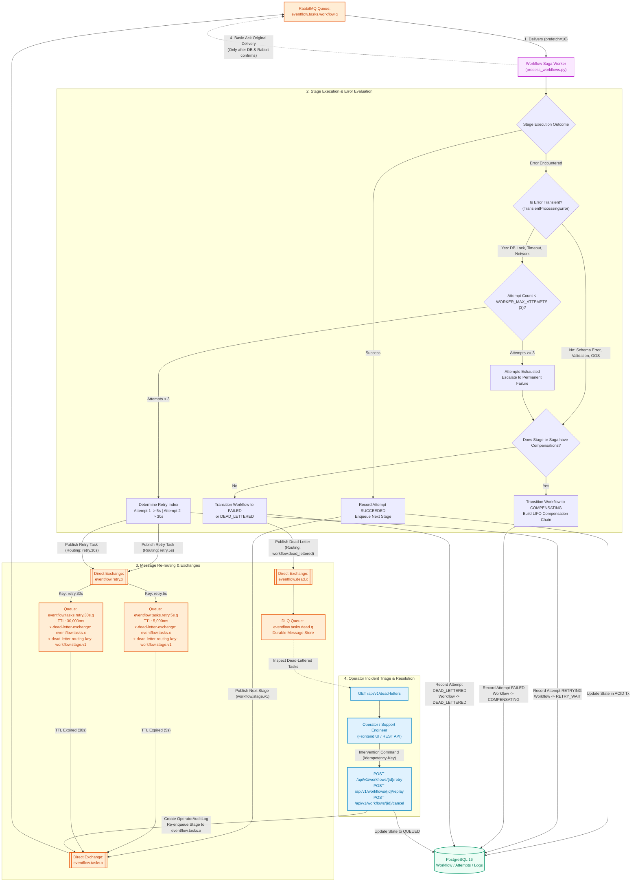

# Diagram 5: Retry, Failure, and Dead-Letter Flow

## Purpose
This document details the failure-handling, exponential backoff retry mechanism, dead-letter routing, and operator intervention capabilities implemented in EventFlow AI. It illustrates how the system distinguishes transient from permanent errors and prevents poison messages from blocking queues.

---

## Failure Handling and Retry Topology Diagram

---

## Transient vs. Permanent Error Classification

EventFlow AI rigorously categorizes all exceptions into two distinct categories in `apps/processing/errors.py`:

| Error Category | Example Causes | System Behavior |
| :--- | :--- | :--- |
| **`TransientProcessingError`** | Database connection timeout, PostgreSQL row lock contention (`OperationalError`), temporary external service unavailability, network partition. | The task is **retried with progressive delay**. Workflow moves to `RETRY_WAIT`. Enqueued to RabbitMQ TTL queues. |
| **`PermanentProcessingError`** | Invalid JSON contract, missing business entities, insufficient inventory stock (`OUT_OF_STOCK`), payment card declined (`PAYMENT_DECLINED`), schema mismatch. | The task is **never retried directly**. Reversible actions trigger compensation; then the workflow transitions to `FAILED` or `DEAD_LETTERED`. Message routes to DLQ. |

---

## Delayed Retry via RabbitMQ Dead-Letter TTL Queues

Traditional worker architectures sleep inside worker processes (`time.sleep(5)`), blocking the worker thread from processing other queue tasks.

EventFlow AI utilizes **RabbitMQ Dead-Letter Exchange TTL Queues**:
1. When a task triggers a transient failure, `PikaRabbitAdapter.publish_retry()` publishes the message to `eventflow.retry.x` with routing key:
   - Attempt 1: `retry.5s` (routes to queue `eventflow.tasks.retry.5s.q` with a message TTL of 5,000 ms).
   - Attempt 2: `retry.30s` (routes to queue `eventflow.tasks.retry.30s.q` with a message TTL of 30,000 ms).
2. The worker immediately acknowledges (`Basic.Ack`) the original task, freeing worker concurrency.
3. The retry queue holds the message without active consumers.
4. When the TTL expires, RabbitMQ automatically dead-letters the message back to `eventflow.tasks.x` with routing key `workflow.stage.v1`.
5. The message re-enters `eventflow.tasks.workflow.q` ready for its next execution attempt.

---

## Dead-Letter Queue (DLQ) and Operator Remediation

When a message exhausts its maximum attempts (`WORKER_MAX_ATTEMPTS = 3`) or encounters a non-recoverable error without compensation:

1. **DLQ Routing**:
   The worker publishes the task to `eventflow.dead.x` with routing key `workflow.dead_lettered`. It lands in `eventflow.tasks.dead.q`.
2. **PostgreSQL Audit State**:
   The workflow state is updated to `DEAD_LETTERED`, recording the terminal `error_code` and `error_detail` in `WorkflowAttempt` and `Workflow`.
3. **Operator Inspection**:
   Operators can view all dead-lettered workflows via `GET /api/v1/dead-letters` or through the Frontend Incident / Workflow views.
4. **Operator Remediation Actions (`apps/workflows/operations.py`)**:
   Operators can issue remediation commands with an `Idempotency-Key`:
   - **Retry (`POST /api/v1/workflows/{id}/retry`)**: Re-enqueues the failed stage to `eventflow.tasks.x` with attempt counter reset.
   - **Replay (`POST /api/v1/workflows/{id}/replay`)**: Re-runs the entire workflow from the initial trigger stage.
   - **Cancel (`POST /api/v1/workflows/{id}/cancel`)**: Permanently marks the workflow as `CANCELLED`, bypassing further queue processing.
   - Every action writes an immutable record to `OperatorAuditLog`.

---

## Implementation Status
- **Status**: Implemented and Verified.
- **Source Paths**:
  - Error Classes: [`apps/processing/errors.py`](file:///d:/eventflow-ai/apps/processing/errors.py)
  - Topology & TTL Config: [`apps/processing/topology.py`](file:///d:/eventflow-ai/apps/processing/topology.py)
  - RabbitMQ Adapter: [`apps/processing/adapters/rabbitmq.py`](file:///d:/eventflow-ai/apps/processing/adapters/rabbitmq.py)
  - Pipeline Execution: [`apps/processing/pipeline.py`](file:///d:/eventflow-ai/apps/processing/pipeline.py)
  - Operator Remediation: [`apps/workflows/operations.py`](file:///d:/eventflow-ai/apps/workflows/operations.py), [`apps/commerce/views.py`](file:///d:/eventflow-ai/apps/commerce/views.py)

