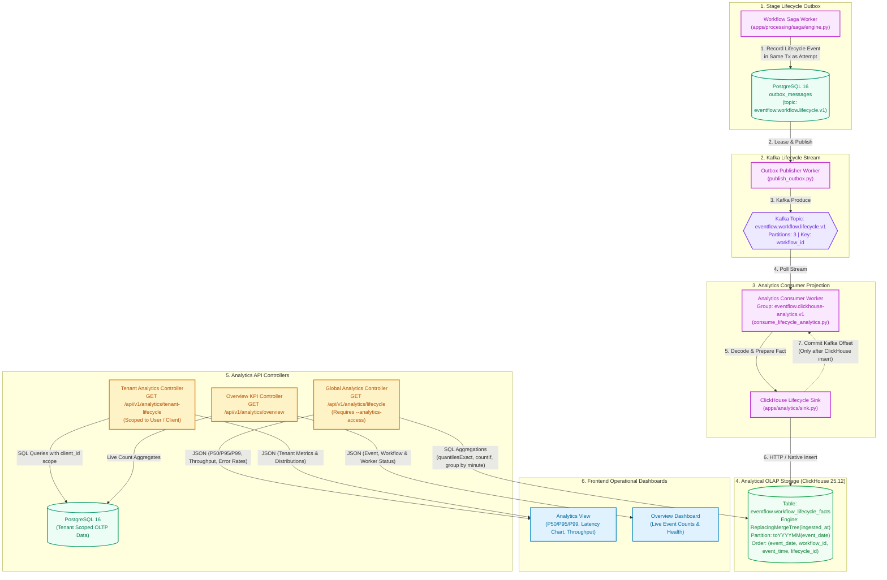

# Diagram 6: Analytics and ClickHouse Data Flow

## Purpose
This document explains the analytical data pipeline in EventFlow AI. It details how operational workflow events are projected from Apache Kafka into **ClickHouse**, how the dual-storage strategy partitions OLTP from OLAP workloads, and how the analytics API serves metrics to the frontend dashboard.

---

## ClickHouse Analytics Data Flow Diagram



---

## Dual-Database Storage Separation: PostgreSQL vs. ClickHouse

| Criteria | PostgreSQL 16 (OLTP) | ClickHouse 25.12 (OLAP) |
| :--- | :--- | :--- |
| **Data Scope** | Mutable current state, state transitions, locking entities, tenant credentials. | Immutable historical lifecycle facts, attempt logs, timestamps. |
| **Write Pattern** | Row-by-row ACID transactions with `SELECT FOR UPDATE` row locks. | High-throughput batch appends of columnar records. |
| **Query Pattern** | Primary-key lookups, relation joins, active workflow updates. | Large-scale aggregations across millions of records without indexes. |
| **Retention** | Active records and bounded audit tables. | Long-term partitioned fact tables partitioned by month (`toYYYYMM`). |
| **Typical Queries** | `SELECT * FROM workflows WHERE id = ?` | `SELECT quantilesExact(0.5, 0.95, 0.99)(duration_ms) FROM ...` |

---

## ClickHouse Schema Specification

The table definition in [`docker/clickhouse/init/001-workflow-lifecycle.sql`](file:///d:/eventflow-ai/docker/clickhouse/init/001-workflow-lifecycle.sql):

```sql
CREATE TABLE IF NOT EXISTS eventflow.workflow_lifecycle_facts
(
    lifecycle_id UUID,
    event_id UUID,
    workflow_id UUID,
    event_time DateTime64(3, 'UTC'),
    event_date Date MATERIALIZED toDate(event_time),
    event_type LowCardinality(String),
    stage LowCardinality(String),
    status LowCardinality(String),
    duration_ms Nullable(UInt32),
    attempt_number UInt16,
    error_code LowCardinality(String),
    correlation_id String,
    ingested_at DateTime64(3, 'UTC') DEFAULT now64(3)
)
ENGINE = ReplacingMergeTree(ingested_at)
PARTITION BY toYYYYMM(event_date)
ORDER BY (event_date, workflow_id, event_time, lifecycle_id);
```

### Key Schema Optimizations:
1. **`ReplacingMergeTree(ingested_at)`**: Automatically deduplicates duplicate messages if an event is replayed or re-delivered from Kafka, keeping the row with the latest `ingested_at` timestamp.
2. **`LowCardinality(String)`**: Employs dictionary encoding for repetitive strings (`event_type`, `stage`, `status`, `error_code`), cutting memory consumption by up to 80% and accelerating grouping queries.
3. **`PARTITION BY toYYYYMM(event_date)`**: Partitions data on disk by calendar month, enabling fast partition pruning when querying specific date intervals.
4. **`ORDER BY (event_date, workflow_id, event_time, lifecycle_id)`**: Organizes data on disk for primary key filtering and cache locality.

---

## Analytics Endpoints and Metrics

### 1. Global ClickHouse Analytics (`/api/v1/analytics/lifecycle`)
- **Permission**: `IsAuthenticated`, `CanViewAnalytics` (requires client created with `--analytics-access`).
- **Data Source**: ClickHouse `workflow_lifecycle_facts`.
- **Calculations (`apps/analytics/queries.py`)**:
  - **Latency Percentiles**: `quantilesExact(0.50, 0.95, 0.99)(duration_ms)` (p50, p95, p99).
  - **Throughput**: `toStartOfMinute(event_time)` grouping for time-series charts.
  - **Success / Failure Rates**: `countIf(status = 'SUCCEEDED') / count()` ratio.
  - **Stage Failure Analysis**: Failure rate breakdown by stage (`validate_order`, `reserve_inventory`, etc.).
  - **Data Lag**: Calculates `data_lag_seconds = now() - latest_event_time` to quantify Kafka projection latency.

### 2. Tenant-Scoped Analytics (`/api/v1/analytics/tenant-lifecycle`)
- **Permission**: Standard `IsAuthenticated` user or client token.
- **Data Source**: PostgreSQL `workflows_workflow` & `workflows_workflowattempt` with `resolve_client_filter()` applied.
- Provides current-state performance metrics strictly scoped to the authenticated tenant.

---

## Implementation Status
- **Status**: Implemented and Verified.
- **Source Paths**:
  - ClickHouse DDL: [`docker/clickhouse/init/001-workflow-lifecycle.sql`](file:///d:/eventflow-ai/docker/clickhouse/init/001-workflow-lifecycle.sql)
  - Analytics Sink: [`apps/analytics/sink.py`](file:///d:/eventflow-ai/apps/analytics/sink.py)
  - Consumer Command: [`apps/analytics/management/commands/consume_lifecycle_analytics.py`](file:///d:/eventflow-ai/apps/analytics/management/commands/consume_lifecycle_analytics.py)
  - Analytical Queries: [`apps/analytics/queries.py`](file:///d:/eventflow-ai/apps/analytics/queries.py)
  - API Views: [`apps/analytics/views.py`](file:///d:/eventflow-ai/apps/analytics/views.py)

