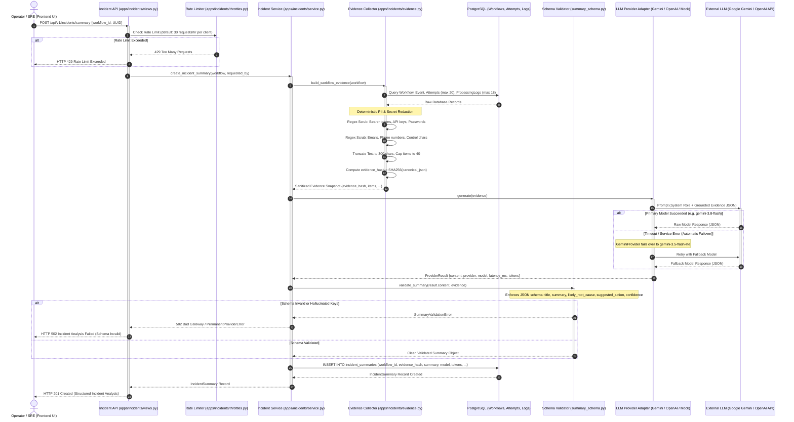

# Diagram 7: AI Operational Intelligence Flow

## Purpose
This document specifies the architecture of the **AI Operational Intelligence and Incident Explanation Engine** in EventFlow AI. It details how runtime workflow evidence is gathered, sanitized, and passed to Large Language Models (LLMs) to generate structured root-cause explanations without compromising data privacy or granting the AI write permissions.

---

## AI Incident Analysis Flow Diagram



---

## Architectural Guardrails: Read-Only Determinism

To maintain strict security and compliance in enterprise environments, EventFlow AI enforces explicit separation between **deterministic operational control** and **probabilistic AI analysis**:

```
┌─────────────────────────────────────────────────────────────┐
│                 DETERMINISTIC APPLICATION CORE               │
│  • Enforces state machine transitions                      │
│  • Executes Saga forward & backward compensation            │
│  • Dispatches tasks and acknowledges RabbitMQ deliveries    │
│  • Owns database ACID transactions and ledger consistency   │
└──────────────────────────────┬──────────────────────────────┘
                               │ (Read-Only Evidence Snapshot)
                               ▼
┌─────────────────────────────────────────────────────────────┐
│                 AI INCIDENT INVESTIGATION ENGINE             │
│  • ZERO write permissions to workflows or orders           │
│  • Cannot trigger retries, replays, or cancellations        │
│  • Cannot alter inventory balances or payment intents       │
│  • Generates ADVISORY root-cause explanations only          │
└─────────────────────────────────────────────────────────────┘
```

---

## Evidence Sanitization Invariants (`apps/incidents/evidence.py`)

Before any data leaves the server boundary to an external LLM API, `build_workflow_evidence()` enforces strict deterministic data minimization:

1. **Secret & Credential Masking**:
   - `password`, `secret`, `api_key`, `access_token` ➔ `[REDACTED]`
   - `Bearer <token>` ➔ `Bearer [REDACTED]`
   - `Authorization: ...` ➔ `Authorization: [REDACTED]`
2. **Personal Data Masking (PII)**:
   - Email addresses matching RFC regex ➔ `[REDACTED_EMAIL]`
   - International & local phone numbers ➔ `[REDACTED_PHONE]`
3. **Bounding & Truncation**:
   - Maximum text length per field: 300 characters.
   - Maximum attempts collected: 20 most recent.
   - Maximum log entries collected: 18 most recent.
   - Total evidence items capped at 40 items.
4. **Content Addressability**:
   - A cryptographic SHA256 checksum (`evidence_hash`) is generated from the canonical JSON representation of the sanitized evidence, ensuring complete auditability between what the LLM saw and what was stored.

---

## Supported LLM Providers (`apps/incidents/providers/`)

EventFlow AI includes three switchable provider adapters via `INCIDENT_LLM_PROVIDER`:

| Provider Adapter | Target Model | Failover Mechanism | Use Case |
| :--- | :--- | :--- | :--- |
| **`mock`** (`DeterministicMockProvider`) | Rule-based engine | None (Local) | Unit tests, CI/CD pipelines, offline development. |
| **`gemini`** (`GeminiProvider`) | `gemini-3.8-flash` | Automatic failover to `gemini-3.5-flash-lite` on timeout. | High-speed production analysis with minimal token cost. |
| **`openai`** (`OpenAIResponsesProvider`) | `gpt-4.1-mini` | Bounded exponential retry (2 attempts). | Alternative enterprise LLM deployment. |

---

## Structured Output Schema (`apps/incidents/summary_schema.py`)

The LLM is constrained to output strict JSON validated against `validate_summary()`. If any required key is missing or invalid, the response is discarded:

```json
{
  "title": "Short incident headline (e.g. Insufficient Inventory During Reservation)",
  "summary": "1-2 sentence high-level overview of what failed and when.",
  "likely_root_cause": "Detailed technical analysis of the failure trigger.",
  "suggested_action": "Prescriptive remediation step for the human operator.",
  "confidence": 0.95,
  "relevant_attempt_ids": ["attempt:<uuid>"],
  "relevant_log_ids": ["log:<uuid>"]
}
```

---

## Implementation Status
- **Status**: Implemented and Verified.
- **Source Paths**:
  - Evidence Extraction & Sanitization: [`apps/incidents/evidence.py`](file:///d:/eventflow-ai/apps/incidents/evidence.py)
  - Core Service: [`apps/incidents/service.py`](file:///d:/eventflow-ai/apps/incidents/service.py)
  - Schema Validation: [`apps/incidents/summary_schema.py`](file:///d:/eventflow-ai/apps/incidents/summary_schema.py)
  - Rate Limiting: [`apps/incidents/throttles.py`](file:///d:/eventflow-ai/apps/incidents/throttles.py)
  - Gemini Adapter: [`apps/incidents/providers/gemini.py`](file:///d:/eventflow-ai/apps/incidents/providers/gemini.py)
  - OpenAI Adapter: [`apps/incidents/providers/openai.py`](file:///d:/eventflow-ai/apps/incidents/providers/openai.py)
  - Mock Adapter: [`apps/incidents/providers/mock.py`](file:///d:/eventflow-ai/apps/incidents/providers/mock.py)

