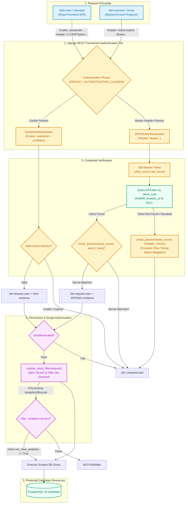

# Diagram 8: Authentication and Request Security

## Purpose
This document details the dual authentication architecture, credential hashing model, multi-client tenant scoping, and authorization checks implemented in EventFlow AI across [`apps/common/`](file:///d:/eventflow-ai/apps/common/).

---

## Authentication and Authorization Flow Diagram



---

## Dual Authentication Modes

EventFlow AI employs two purpose-built authentication schemes:

### 1. Bearer API Client Authentication (`APIClientAuthentication`)
Designed for **service-to-service automation** (microservices, event producers, automated test runners):
- **Header Format**: `Authorization: Bearer <client-uuid>.<client-secret>`
- **Storage Model**: The raw secret is **never stored** in the database. Only its PBKDF2 hash (`secret_hash`) is persisted.
- **Timing Attack Defense**: If a client UUID does not exist or has been revoked, `APIClientAuthentication` still executes `check_password()` against a precomputed dummy hash (`_DUMMY_SECRET_HASH`). This ensures response time is identical regardless of whether a client ID is valid, thwarting user-enumeration timing attacks.

### 2. Session Authentication (`SessionAuthentication`)
Designed for **interactive human operators** accessing the React SPA:
- **Endpoints**:
  - `POST /api/v1/auth/register` (User registration, auto-creates default `APIClient`)
  - `POST /api/v1/auth/login` (Establishes session, sets secure HTTP-only cookies)
  - `POST /api/v1/auth/logout` (Invalidates session)
  - `GET /api/v1/auth/me` (Returns authenticated user profile and owned client workspaces)
- **Protection**: Enforces Django CSRF validation (`X-CSRFToken` header) and `SameSite` cookie policies.

---

## Workspace Multi-Client Tenancy & Scoping (`apps/common/scope.py`)

In enterprise event platforms, data isolation between tenants is critical. EventFlow AI enforces query scoping at the ORM query level through `resolve_client_filter(request, prefix="client")`:

```python
def resolve_client_filter(request, prefix="client"):
    user = getattr(request, "user", None)
    if not user or not user.is_authenticated:
        return Q(pk__in=[])  # Deny all for anonymous

    if isinstance(user, APIClient):
        # Service token: strictly match client == APIClient
        return Q(**{prefix: user})

    if isinstance(user, User):
        if user.is_staff:
            return Q()  # Staff users can see across workspaces
        # Web user: match records owned by any APIClient belonging to this user
        owner_field = f"{prefix}__owner"
        return Q(**{owner_field: user})

    return Q(pk__in=[])
```

### Tenancy Guarantees:
1. **API Client Ingress**: An API client can only ever inspect and query records whose `client_id` matches its own primary key.
2. **User Workspace Isolation**: A logged-in user can view all entities owned by their active clients, but cannot access data belonging to other registered users.
3. **Workspace Filter Dropdown**: In the React dashboard, users owning multiple client workspaces (e.g. `Default Client` and `Test Client`) can selectively filter inventory, workflows, and orders by client workspace using `?client_id=<uuid>`.

---

## Implementation Status
- **Status**: Implemented and Verified.
- **Source Paths**:
  - Bearer Token Auth: [`apps/common/authentication.py`](file:///d:/eventflow-ai/apps/common/authentication.py)
  - Auth Views & Endpoints: [`apps/common/auth_views.py`](file:///d:/eventflow-ai/apps/common/auth_views.py), [`apps/common/auth_urls.py`](file:///d:/eventflow-ai/apps/common/auth_urls.py)
  - Tenancy & Scope Filters: [`apps/common/scope.py`](file:///d:/eventflow-ai/apps/common/scope.py)
  - Client Management CLI: [`apps/common/management/commands/client_credentials.py`](file:///d:/eventflow-ai/apps/common/management/commands/client_credentials.py)
  - Analytics Permission: [`apps/analytics/permissions.py`](file:///d:/eventflow-ai/apps/analytics/permissions.py)

