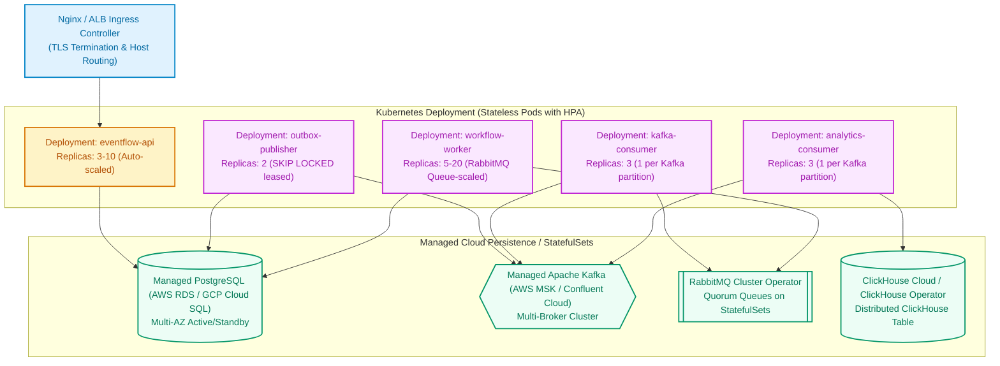

# Diagram 9: Deployment and Infrastructure Architecture

## Purpose
This document presents the actual physical container topology, networking, volume mounts, and environment configuration of EventFlow AI in Docker Compose. It also outlines the **planned** target Kubernetes architecture for high-availability enterprise scaling.

---

## Current Deployment Topology: Docker Compose

```mermaid
flowchart TD
    %% Styling
    classDef clientStyle fill:#e0f2fe,stroke:#0284c7,stroke-width:2px,color:#0369a1;
    classDef webStyle fill:#fef3c7,stroke:#d97706,stroke-width:2px,color:#b45309;
    classDef stateStyle fill:#ecfdf5,stroke:#059669,stroke-width:2px,color:#047857;
    classDef brokerStyle fill:#ede9fe,stroke:#7c3aed,stroke-width:2px,color:#6d28d9;
    classDef workerStyle fill:#fae8ff,stroke:#c026d3,stroke-width:2px,color:#a21caf;
    classDef volStyle fill:#f1f5f9,stroke:#64748b,stroke-width:2px,color:#334155;
    classDef extStyle fill:#fff1f2,stroke:#e11d48,stroke-width:2px,color:#be123c;

    subgraph ExternalAccess["External Access / Host (127.0.0.1)"]
        Browser["Web Operator Browser<br/>http://localhost:5173 (Dev)"]:::clientStyle
        APIClient["API Ingress Client<br/>http://localhost:8000"]:::clientStyle
        PGPort["Postgres Port: 5433"]:::clientStyle
        RabbitUIPort["Rabbit Management: 15672"]:::clientStyle
        KafkaPort["Kafka External: 29092"]:::clientStyle
        ClickHousePort["ClickHouse HTTP: 8123"]:::clientStyle
    end

    subgraph DockerBridge["Docker Network: eventflow-ai_default"]
        subgraph WebTier["Application Ingress Tier"]
            MigrateInit["Container: migrate<br/>(python manage.py migrate)"]:::webStyle
            APIContainer["Container: api<br/>(Django REST / Gunicorn)<br/>Port 8000"]:::webStyle
        end

        subgraph WorkerTier["Dedicated Asynchronous Worker Fleet"]
            OutboxPub["Container: outbox-publisher<br/>(manage.py publish_outbox)<br/>Metrics Port: 9101:9100"]:::workerStyle
            KafkaConsumer["Container: kafka-consumer<br/>(manage.py consume_domain_events)<br/>Metrics Port: 9102:9100"]:::workerStyle
            WorkflowWorker["Container: workflow-worker<br/>(manage.py process_workflows)<br/>Metrics Port: 9103:9100"]:::workerStyle
            AnalyticsConsumer["Container: analytics-consumer<br/>(manage.py consume_lifecycle_analytics)<br/>Metrics Port: 9104:9100"]:::workerStyle
        end

        subgraph StorageBrokers["Persistent Brokers & Storage Engines"]
            PostgresDB["Container: db<br/>postgres:16.6-bookworm<br/>Internal Port: 5432"]:::stateStyle
            KafkaBroker["Container: kafka<br/>apache/kafka:4.3.2 (KRaft Mode)<br/>Internal Ports: 9092, 9093"]:::brokerStyle
            KafkaInit["Container: kafka-init<br/>(Creates 3 Kafka Topics)"]:::brokerStyle
            RabbitMQBroker["Container: rabbitmq<br/>rabbitmq:4.2-management<br/>Internal Ports: 5672, 15672"]:::brokerStyle
            ClickHouseServer["Container: clickhouse<br/>clickhouse/clickhouse-server:25.12<br/>Internal Port: 8123"]:::stateStyle
        end
    end

    subgraph Volumes["Persistent Docker Named Volumes"]
        VolPG[("Volume: postgres_data<br/>/var/lib/postgresql/data")]:::volStyle
        VolKafka[("Volume: kafka_data<br/>/var/lib/kafka/data")]:::volStyle
        VolRabbit[("Volume: rabbitmq_data<br/>/var/lib/rabbitmq")]:::volStyle
        VolCH[("Volume: clickhouse_data<br/>/var/lib/clickhouse")]:::volStyle
    end

    subgraph ExternalCloud["External SaaS Cloud Services"]
        GeminiAPI["Google Gemini API<br/>(generativelanguage.googleapis.com)"]:::extStyle
        OpenAIAPI["OpenAI API<br/>(api.openai.com)"]:::extStyle
    end

    %% Port Mappings
    APIClient -->|":8000"| APIContainer
    PGPort -->|":5433 -> :5432"| PostgresDB
    RabbitUIPort -->|":15672"| RabbitMQBroker
    KafkaPort -->|":29092"| KafkaBroker
    ClickHousePort -->|":8123"| ClickHouseServer

    %% Startup Dependencies
    MigrateInit -.->|"depends_on (service_healthy)"| PostgresDB
    APIContainer -.->|"depends_on (service_completed)"| MigrateInit
    KafkaInit -.->|"depends_on (service_healthy)"| KafkaBroker
    OutboxPub -.->|"depends_on"| MigrateInit
    OutboxPub -.->|"depends_on"| KafkaInit
    KafkaConsumer -.->|"depends_on"| RabbitMQBroker
    KafkaConsumer -.->|"depends_on"| KafkaInit
    WorkflowWorker -.->|"depends_on"| RabbitMQBroker
    AnalyticsConsumer -.->|"depends_on"| ClickHouseServer

    %% Runtime Communications
    APIContainer --> PostgresDB
    OutboxPub --> PostgresDB
    OutboxPub --> KafkaBroker
    KafkaConsumer --> KafkaBroker
    KafkaConsumer --> RabbitMQBroker
    WorkflowWorker --> RabbitMQBroker
    WorkflowWorker --> PostgresDB
    AnalyticsConsumer --> KafkaBroker
    AnalyticsConsumer --> ClickHouseServer

    %% Volume Mounts
    PostgresDB --- VolPG
    KafkaBroker --- VolKafka
    RabbitMQBroker --- VolRabbit
    ClickHouseServer --- VolCH

    %% External AI egress
    APIContainer -.->|HTTPS Egress| GeminiAPI
    APIContainer -.->|HTTPS Egress| OpenAIAPI
```

---

## Docker Compose Services Inventory

| Service Name | Base Image | Command / Entrypoint | Internal Ports | Host Ports | Primary Responsibility |
| :--- | :--- | :--- | :--- | :--- | :--- |
| **`db`** | `postgres:16.6-bookworm` | Standard entrypoint | `5432` | `5433:5432` | Primary OLTP database for events, sagas, outbox, and users. |
| **`migrate`** | Local Dockerfile | `python manage.py migrate --noinput` | — | — | Runs Django schema migrations before application startup. |
| **`api`** | Local Dockerfile | `gunicorn` / DRF web server | `8000` | `8000:8000` | Ingress REST API for events, workflows, commerce, and incidents. |
| **`kafka`** | `apache/kafka:4.3.2` | KRaft broker & controller | `9092`, `9093` | `29092:29092` | Distributed streaming log for domain events & lifecycle facts. |
| **`kafka-init`** | `apache/kafka:4.3.2` | `kafka-topics.sh --create` | — | — | Creates initial partitioned topics on startup. |
| **`rabbitmq`** | `rabbitmq:4.2-management` | RabbitMQ server | `5672`, `15672` | `5672`, `15672` | AMQP task queue, TTL retry queues, and dead-letter exchange. |
| **`clickhouse`** | `clickhouse/clickhouse-server:25.12` | ClickHouse server | `8123` | `8123:8123` | Columnar OLAP engine for lifecycle facts and latency percentiles. |
| **`outbox-publisher`** | Local Dockerfile | `python manage.py publish_outbox` | `9100` | `9101:9100` | Polls PostgreSQL outbox and publishes records to Kafka. |
| **`kafka-consumer`** | Local Dockerfile | `python manage.py consume_domain_events` | `9100` | `9102:9100` | Consumes Kafka domain events and enqueues tasks to RabbitMQ. |
| **`workflow-worker`** | Local Dockerfile | `python manage.py process_workflows` | `9100` | `9103:9100` | Consumes RabbitMQ tasks and executes Saga stage state machine. |
| **`analytics-consumer`** | Local Dockerfile | `python manage.py consume_lifecycle_analytics` | `9100` | `9104:9100` | Consumes Kafka lifecycle events and batch-inserts into ClickHouse. |

---

## Planned Architecture: Target Kubernetes Topology

> [!IMPORTANT]
> **Status: Planned / Not Implemented**
> Kubernetes manifests and Helm charts are not currently committed to the repository. The diagram below illustrates the target architectural mapping when migrating from single-node Docker Compose to an enterprise multi-node cluster (e.g. AWS EKS or GCP GKE).

---

## Migration Mapping: Docker Compose to Kubernetes

| Docker Compose Component | Kubernetes Native Equivalent | Scaling Strategy |
| :--- | :--- | :--- |
| `api` | `Deployment` + `Service` (ClusterIP) + `Ingress` | Horizontal Pod Autoscaler (HPA) based on CPU / Request Rate. |
| `outbox-publisher` | `Deployment` (2 replicas) | Concurrency managed safely by PostgreSQL `SKIP LOCKED`. |
| `kafka-consumer` | `Deployment` (3 replicas) | Scaled up to partition count (3 partitions on domain topic). |
| `workflow-worker` | `Deployment` (3 to 20 replicas) | KEDA (Kubernetes Event-driven Autoscaling) scaled on RabbitMQ queue depth. |
| `analytics-consumer` | `Deployment` (3 replicas) | Scaled up to partition count (3 partitions on lifecycle topic). |
| `db`, `kafka`, `clickhouse` | Managed Cloud Services (RDS, MSK, ClickHouse Cloud) | Avoid running stateful distributed brokers inside self-managed K8s pods. |

---

## Implementation Status
- **Docker Compose Topology**: Implemented and Verified.
- **Kubernetes Architecture**: **Planned / Not Implemented** (No `.yaml` manifests or Helm charts in repository).
- **Source Paths**:
  - Compose File: [`docker-compose.yml`](file:///d:/eventflow-ai/docker-compose.yml)
  - Dockerfiles: [`Dockerfile`](file:///d:/eventflow-ai/Dockerfile), [`frontend/Dockerfile`](file:///d:/eventflow-ai/frontend/Dockerfile)
  - ClickHouse Init: [`docker/clickhouse/init/001-workflow-lifecycle.sql`](file:///d:/eventflow-ai/docker/clickhouse/init/001-workflow-lifecycle.sql)

