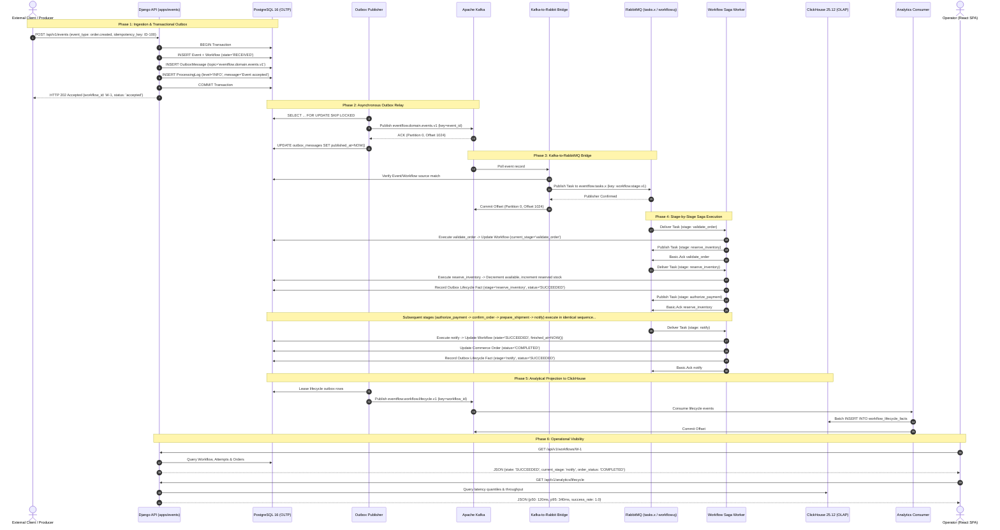
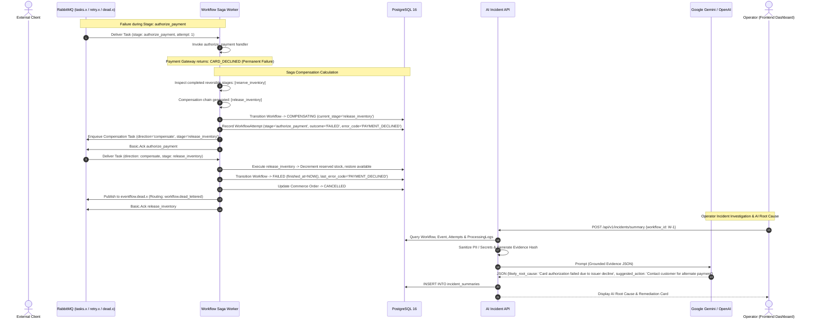

# Diagram 10: End-to-End Event Lifecycle Sequence

## Purpose
This document presents the complete end-to-end sequence of an event traversing the entire EventFlow AI platform. It tracks an event from initial HTTP ingestion through the transactional outbox, dual-broker pipeline, saga execution, analytics projection, failure compensation, and frontend operational visualization.

---

## 1. Happy Path: Successful Event Ingestion to Saga Completion

The sequence below traces an `order.created` event executing the 6 stages of `order_fulfillment` (`validate_order` ➔ `reserve_inventory` ➔ `authorize_payment` ➔ `confirm_order` ➔ `prepare_shipment` ➔ `notify`).

---

## 2. Failure Path: Payment Failure, Backward Compensation & AI Explanation

The sequence below illustrates what happens when `authorize_payment` permanently fails (e.g. `PAYMENT_DECLINED`). The saga engine rolls back previously reserved inventory (`release_inventory`), marks the workflow `FAILED`, routes to the dead-letter queue, and generates an AI incident root-cause analysis.

---

## Lifecycle Guarantee Highlights

1. **Transactional Ingress**: The event acceptance is committed in PostgreSQL before any broker interaction takes place.
2. **Durable Asynchronous Bridge**: Kafka offsets are only committed when RabbitMQ confirms that the task message is safely persisted on disk.
3. **Compensating Consistency**: In distributed transactions without two-phase commit (2PC), EventFlow AI relies on **Saga compensation** to ensure that failed payments do not leave stranded inventory reservations.
4. **Isolated Analytics & AI**: Neither analytical queries against ClickHouse nor AI investigations against LLM providers take read locks on active PostgreSQL saga rows, keeping the transactional core completely unaffected by reporting or incident analysis workloads.

---

## Implementation Status
- **Status**: Implemented and Verified.
- **Source Paths**:
  - Ingestion: [`apps/events/services.py`](file:///d:/eventflow-ai/apps/events/services.py)
  - Bridge: [`apps/processing/pipeline.py`](file:///d:/eventflow-ai/apps/processing/pipeline.py)
  - Saga Engine: [`apps/processing/saga/engine.py`](file:///d:/eventflow-ai/apps/processing/saga/engine.py)
  - Incident Engine: [`apps/incidents/service.py`](file:///d:/eventflow-ai/apps/incidents/service.py)
  - Analytics Sink: [`apps/analytics/sink.py`](file:///d:/eventflow-ai/apps/analytics/sink.py)

