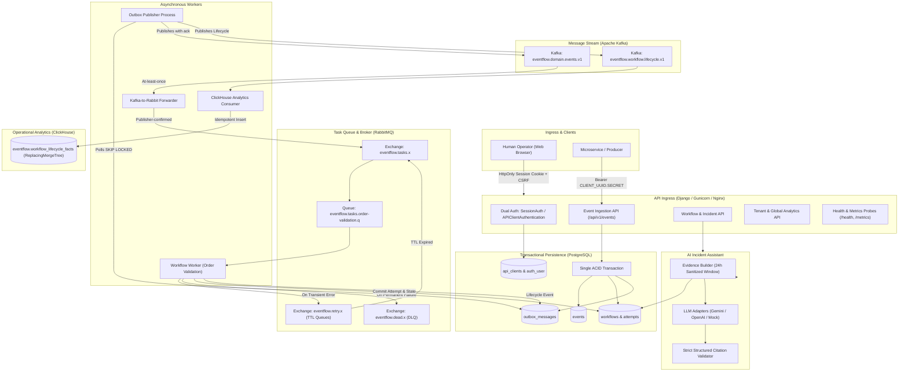

# EventFlow AI — System Architecture Overview

EventFlow AI is an enterprise-grade, event-driven workflow orchestration and operational intelligence platform. It bridges high-throughput asynchronous event ingestion, guaranteed transactional processing, resilient message-broker topologies, real-time lifecycle analytics, and an evidence-grounded AI incident investigation engine.

---

## High-Level Architecture Diagram



---

## 1. Dual-Tier Authentication & Tenant Isolation

EventFlow AI enforces a strict multi-tier identity and tenant boundary:

### 1.1 Human Operators (Web Console)
- **Mechanism:** Standard Django session authentication over encrypted, `HttpOnly`, `SameSite=Lax`, `Secure` cookies.
- **CSRF Protection:** Native CSRF tokens (`django.middleware.csrf.CsrfViewMiddleware`) initialized via `/api/v1/auth/csrf` and required on state-mutating requests.
- **Endpoints:** `/api/v1/auth/register`, `/api/v1/auth/login`, `/api/v1/auth/logout`, `/api/v1/auth/me`, `/api/v1/auth/password-reset`.
- **API Client Provisioning:** Authenticated users manage their ingestion credentials directly in the console (`GET /api/v1/clients`, `POST /api/v1/clients`, `POST /api/v1/clients/{id}/revoke`).

### 1.2 Machine-to-Machine Ingestion (Microservices)
- **Mechanism:** HTTP Authorization Bearer tokens formatted as `<CLIENT_UUID>.<SECRET>`.
- **Cryptographic Storage:** Raw secrets are 32-byte URL-safe tokens shown only once upon creation. Only cryptographic hashes (`PBKDF2SHA256`) are persisted in the database.
- **Timing Attack Mitigation:** Missing clients trigger constant-time dummy password hashing before returning `401 Unauthorized`.
- **Revocation & Rotation:** Instantaneous revocation via `revoked_at` timestamp. Key rotation invalidates previous credentials immediately.

### 1.3 Tenant Isolation
- Data records (`Event`, `Workflow`, `IncidentSummary`) are strictly scoped by API Client ownership.
- Operators query records owned by their associated clients or organization workspace. Staff/administrators have explicit platform-wide oversight.

---

## 2. Transactional Ingestion & Outbox Pattern

To eliminate dual-write hazards and distributed inconsistencies, event ingestion is strictly transactional:

```text
HTTP POST /api/v1/events
  │
  ├── Validate JSON Schema & Payload constraints (Order, Currency, Items)
  ├── Check Idempotency: (client_id, source, idempotency_key)
  │     ├── If duplicate exists: Return 200 OK with original IDs (duplicate=true)
  │     └── If new:
  │           BEGIN TRANSACTION (PostgreSQL)
  │             ├── INSERT INTO events
  │             ├── INSERT INTO workflows (state='RECEIVED')
  │             ├── INSERT INTO processing_logs
  │             └── INSERT INTO outbox_messages (topic='eventflow.domain.events.v1')
  │           COMMIT TRANSACTION
  │           Return 201 Created
```

- **Database Uniqueness Constraint:** The PostgreSQL unique constraint on `(client_id, source, idempotency_key)` is authoritative and guarantees idempotency even under concurrent network replays or producer race conditions.
- **Outbox Publisher:** An independent daemon leases unpublished outbox records in small batches using `SELECT ... FOR UPDATE SKIP LOCKED`. Messages are published to Kafka with synchronous broker acknowledgment before leasing states are committed.

---

## 3. Resilient Broker Topology & Execution Semantics

The message pipeline decouples domain event broadcasting from reliable point-to-point worker task execution:

1. **Kafka (Domain & Lifecycle Streaming):**
   - Topic `eventflow.domain.events.v1`: Partitioned by `event_id` to guarantee per-event ordering while scaling across partitions.
   - Topic `eventflow.workflow.lifecycle.v1`: Emits real-time state transitions (`workflow.processing`, `workflow.succeeded`, `workflow.failed`, `workflow.dead_lettered`).
2. **Kafka-to-RabbitMQ Bridge:**
   - Consumes Kafka events in consumer group `eventflow.kafka-to-rabbit.v1`.
   - Disables auto-commit; forwards tasks to RabbitMQ with publisher confirms.
   - Commits Kafka offsets only after RabbitMQ confirms durable enqueueing.
3. **RabbitMQ Task Queue & Dead-Letter Exchanges:**
   - **Task Exchange (`eventflow.tasks.x`):** Direct exchange routing events to durable quorum queues (`eventflow.tasks.order-validation.q`).
   - **Retry Exchange (`eventflow.retry.x`):** Dead-letter routing with message TTL (exponential backoff queues) returning unacknowledged transient errors back to the primary task queue.
   - **Dead-Letter Exchange (`eventflow.dead.x`):** Routes exhausted retries or non-retriable business failures directly to `eventflow.tasks.dead.q`.
4. **Worker Execution:**
   - Processes tasks in atomic database transactions.
   - Attempts are tracked in `workflow_attempts` with `(workflow_id, stage, attempt_number)` unique constraints.
   - If a worker crashes between database commit and message acknowledgment, the duplicate delivery is recognized and safely acknowledged without re-executing business logic.

---

## 4. Real-Time & Lifecycle Analytics

EventFlow AI separates transactional operational queries from analytical aggregation:

1. **Tenant-Scoped Operational Analytics (PostgreSQL):**
   - Serves the default dashboard and `/api/v1/analytics/tenant-lifecycle`.
   - Provides current-state counts, success/failure ratios, and recent activity scoped to the client.
2. **Global Lifecycle Analytics (ClickHouse):**
   - Consumes from `eventflow.workflow.lifecycle.v1` in group `eventflow.clickhouse-analytics.v1`.
   - Ingests into `eventflow.workflow_lifecycle_facts` using `ReplacingMergeTree` partitioned by month and ordered by `(event_date, workflow_id, recorded_at, lifecycle_id)`.
   - Query-time deduplication via `FINAL` ensures idempotent data aggregation even during Kafka replays.
   - Bounded queries (`GET /api/v1/analytics/lifecycle`) require explicit `can_view_analytics` permissions.

---

## 5. Evidence-Grounded AI Incident Assistant

When workflows fail or enter dead-letter queues, operators can trigger automated root-cause analysis via `POST /api/v1/workflows/{workflow_id}/incident-summary`:

- **Evidence Gathering:** Collects a bounded 24-hour snapshot of sanitized attempt records and processing logs (at most 20 attempts, 18 logs, 40 total items). Payloads and sensitive attributes are strictly excluded.
- **Provider Adapters:** Supports **Google Gemini** (`gemini-3.5-flash-lite` with automatic fallback) and **OpenAI** (`gpt-4o-mini`), alongside a deterministic local mock provider.
- **Zero-Hallucination Evidence Grounding:** All claims, confirmed facts, and hypotheses must reference explicit evidence IDs from the supplied context. A strict validation layer inspects citations before persisting.
- **Security & Read-Only Invariance:** The AI assistant operates strictly as an explanation system: it cannot mutate workflow states, execute database queries, or publish broker messages.

---

## 6. Observability & Production Readiness

- **Structured JSON Logging:** All log events include contextual metadata: `timestamp`, `level`, `logger`, `request_id`, `trace_id`, `event_id`, and `workflow_id`.
- **Prometheus Metrics (`/metrics`):** Text metrics covering HTTP latencies, outbox backlog, worker queue depths, dead-letter rates, and LLM call latencies. Gated by `X-Metrics-Token`.
- **Health Probes:**
  - `/health/live`: Fast process liveness probe.
  - `/health/ready`: Database connectivity readiness probe.
  - `/health/services`: Detailed internal component probe (PostgreSQL, Kafka, RabbitMQ, ClickHouse, Workers).
- **Least-Privilege Security:** Production deployments enforce separate PostgreSQL database migration vs. application roles, non-root Docker execution (UID 10001), and mandatory TLS across all external and internal connections.
