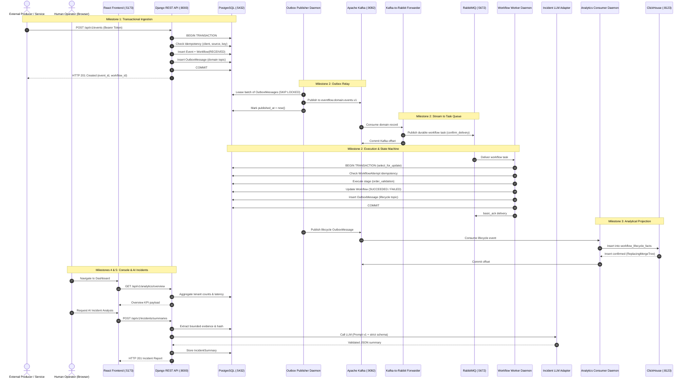

# EventFlow AI — Senior Full-Stack & Event-Driven Architecture Audit

**Author:** Principal EDA Architect, Senior Backend Engineer & Application Security Reviewer  
**Audit Date:** November 2026  
**Repository:** `d:\eventflow-ai`  
**Git Commit Baseline:** `edba6f1` (Working state, clean working tree)  
**Target Architecture:** Distributed Event-Driven Orchestration with Dual-Tier Authentication

---

## 1. Executive Summary

### 1.1 Current Maturity & System Posture
EventFlow AI is an advanced, production-oriented event-driven workflow orchestration and operational intelligence platform. Across milestones M1 through M5, the platform exhibits exceptionally strong distributed systems fundamentals:
- **Transactional Consistency:** Atomic multi-table writes combining PostgreSQL row updates with transactional outbox messages (`apps/events/views.py:85-115`, `apps/processing/workflow_service.py:173-205`).
- **At-Least-Once Broker Topology:** Dual-broker architecture using Kafka for high-throughput partitioned domain event streams and RabbitMQ for competing-consumer workflow execution tasks with exponential backoff and dead-letter exchanges (`apps/processing/adapters/`).
- **Idempotency & Deduplication:** Triple-tier idempotency: HTTP layer client idempotency keys, worker attempt persistence (`apps/workflows/models.py:WorkflowAttempt`), and analytical deduplication via ClickHouse `ReplacingMergeTree` (`docker/clickhouse/init/001-workflow-lifecycle.sql`).
- **Grounded AI Investigations:** Deterministic, schema-validated incident diagnosis with SHA-256 evidence hashing and model failover (`apps/incidents/service.py:62-130`).

### 1.2 Primary Architectural & Security Risks
Despite high distributed runtime maturity, the platform has one major architectural bottleneck: **Authentication & Identity Architecture**.
1. **Zero Human User Authentication:** The platform lacks user signup, login, logout, password recovery, session handling, and user profiles.
2. **Machine Credentials in Browser Memory:** Human operators are required to run backend CLI commands (`manage.py client_credentials create`), generate raw machine tokens, and paste them into the frontend. Tokens are held in JavaScript memory (`frontend/src/api/auth-token.ts`) and wiped on browser refresh.
3. **Rigid "Tenant == APIClient" Coupling:** Data isolation is tightly coupled to individual `APIClient` IDs. There is no concept of a user owning multiple API clients or an organization workspace.
4. **Missing Browser CORS Configuration:** `django-cors-headers` is not installed; the frontend relies entirely on a development-only Vite reverse proxy (`frontend/vite.config.ts:13-18`).

### 1.3 Readiness Assessment Summary
- **Local Development:** **READY (PASS)** — All Docker Compose services, background workers, and local unit/integration tests run cleanly.
- **Portfolio Demo:** **CONDITIONALLY READY** — Works well for technical demos where the demonstrator pastes a generated credential, but unacceptable for self-service evaluation.
- **Team Testing / Staging / Production:** **NOT READY (NO-GO)** — Blocked on user registration, session persistence, browser credential isolation, and production CORS/CSRF handling.

---

## 2. Architecture Overview & Event Flow

### 2.1 Component Interaction & Distributed Event Flow



---

## 3. Prioritized Audit Findings

### Legend
- **P0 (Critical):** Immediate security risk, data loss vulnerability, or system blocker.
- **P1 (High):** Major functional gap, architectural defect, or operational reliability issue.
- **P2 (Medium):** Incomplete integration, performance inefficiency, or maintainability risk.
- **P3 (Low):** Minor polish, developer experience, or documentation discrepancy.
- **P4 (Deferred):** Explicitly postponed scope (e.g. Kubernetes, massive load testing).

---

### [P0] Critical Findings

#### FINDING-01: Complete Absence of Human User Authentication and Session Management
- **Layer:** Authentication / Frontend / Backend
- **Affected Files:**
  - `config/settings/base.py:145-153`
  - `apps/common/authentication.py:12-36`
  - `frontend/src/app/auth.tsx:1-42`
  - `frontend/src/api/auth-token.ts:1-6`
- **Evidence:**
  `REST_FRAMEWORK["DEFAULT_AUTHENTICATION_CLASSES"]` contains exclusively `apps.common.authentication.APIClientAuthentication`. No registration, login, logout, password reset, or current-user endpoints exist in `config/urls.py` or any app URL conf. Frontend relies on manual token input.
- **Impact:**
  New users cannot register or use EventFlow AI independently. Human operators must use raw machine tokens intended for server-to-server daemon processes. All credentials are lost whenever the browser tab is refreshed.
- **Recommended Correction:**
  Implement dual-tier authentication. Add Django Session Authentication for browser users (`/api/v1/auth/register`, `/api/v1/auth/login`, `/api/v1/auth/logout`, `/api/v1/auth/me`) using secure HttpOnly cookies, while preserving `APIClientAuthentication` for machine event ingestion.

#### FINDING-02: Missing Production CORS Configuration for Decoupled Frontend
- **Layer:** Security / Network
- **Affected Files:**
  - `config/settings/base.py:62-88`
  - `pyproject.toml:11-22`
  - `frontend/vite.config.ts:13-18`
- **Evidence:**
  `django-cors-headers` is not installed in `pyproject.toml` and not present in `INSTALLED_APPS` or `MIDDLEWARE`. Cross-origin browser requests directly from a distinct web domain (e.g., `https://console.eventflow.ai` to `https://api.eventflow.ai`) will be rejected by browser SOP (Same-Origin Policy).
- **Impact:**
  Frontend only works in local development because Vite proxies requests on the same origin (`localhost:5173/api -> localhost:8000/api`). Any non-proxied deployment fails completely.
- **Recommended Correction:**
  Install `django-cors-headers`, configure `corsheaders.middleware.CorsMiddleware`, and restrict `CORS_ALLOWED_ORIGINS` via environment variables with `CORS_ALLOW_CREDENTIALS = True`.

---

### [P1] High Priority Findings

#### FINDING-03: Tenant Isolation Tightly Coupled to Machine Client ID with No User Ownership
- **Layer:** Data Architecture / Multitenancy
- **Affected Files:**
  - `apps/common/models.py:6-27`
  - `apps/events/models.py:8`
  - `apps/workflows/models.py:17`
  - `apps/incidents/models.py:11-13`
  - `apps/events/views.py:53, 145`
- **Evidence:**
  `APIClient` has no foreign key to a user or organization. `Event.client`, `Workflow.event.client`, and `IncidentSummary.requested_by` all point to `common.APIClient`. In all views, tenant filtering is implemented as `filter(client=request.user)`.
- **Impact:**
  When a human user registers, they have no mechanism to own, manage, or associate with API clients. If user authentication is added naively, `request.user` would be an `auth.User`, breaking every existing queryset filter expecting an `APIClient`.
- **Recommended Correction:**
  Add `owner = models.ForeignKey(settings.AUTH_USER_MODEL, null=True, blank=True, on_delete=models.CASCADE, related_name="api_clients")` to `APIClient`. Add queryset resolution helper that checks:
  - If `request.user` is `APIClient`: filter `client=request.user`.
  - If `request.user` is `User`: filter `client__owner=request.user` (or all if `is_staff`).

#### FINDING-04: Lack of Self-Service API Client Provisioning in the Web UI
- **Layer:** Frontend / Management APIs
- **Affected Files:**
  - `apps/common/management/commands/client_credentials.py`
  - `frontend/src/features/settings/SettingsPage.tsx:25-36`
- **Evidence:**
  The only way to create, view, or revoke API client credentials is via the CLI command `python manage.py client_credentials create`. The frontend Settings page merely displays a code snippet instructing the user to run Docker commands.
- **Impact:**
  Non-technical users or developers without SSH/Docker access cannot provision event ingestion tokens for their applications.
- **Recommended Correction:**
  Expose authenticated user endpoints:
  - `GET /api/v1/clients`: List user's active API clients (UUID, name, created date, analytics permission).
  - `POST /api/v1/clients`: Create client, returning raw secret once.
  - `POST /api/v1/clients/{id}/revoke`: Revoke client.
  Add client management UI inside `SettingsPage.tsx`.

#### FINDING-05: In-Memory Token Handling Causes Broken User Experience on Page Refresh
- **Layer:** Frontend State Management
- **Affected Files:**
  - `frontend/src/api/auth-token.ts:1-6`
  - `frontend/src/app/auth.tsx:16-35`
- **Evidence:**
  `apiToken` is stored in a JavaScript module variable `let apiToken: string | null = null`. No persistence layer (cookie or secure storage) exists.
- **Impact:**
  Pressing F5 or opening a deep link immediately logs the user out, rendering empty states across the application and forcing the user to re-paste the client credential in Settings.
- **Recommended Correction:**
  Transition to session-cookie authentication. On page mount, the frontend calls `GET /api/v1/auth/me`. If the session cookie is valid, user state is restored automatically.

---

### [P2] Medium Priority Findings

#### FINDING-06: Celery / Async Worker Infrastructure Is Ad-Hoc Management Commands
- **Layer:** Backend Infrastructure / Execution
- **Affected Files:**
  - `apps/processing/management/commands/publish_outbox.py`
  - `apps/processing/management/commands/consume_domain_events.py`
  - `apps/processing/management/commands/process_workflows.py`
  - `apps/analytics/management/commands/consume_lifecycle_analytics.py`
- **Evidence:**
  All four background workers are written as continuous `while True:` loops inside Django management commands using `time.sleep()`.
- **Impact:**
  While completely functional for MVP/demo and robustly handling SIGINT/SIGTERM, it lacks distributed task management features (task deadlocks, dynamic concurrency scaling, centralized task monitoring) typically provided by Celery or Temporal.
- **Recommended Correction:**
  Preserve current lightweight commands for Docker Compose development; consider Celery or dedicated consumer processes when scaling beyond single-instance worker nodes.

#### FINDING-07: Incident Diagnosis Is Strictly On-Demand Without Automatic Triggering
- **Layer:** AI Incidents / Automation
- **Affected Files:**
  - `apps/incidents/views.py:27-58`
  - `apps/processing/workflow_service.py:280-318`
- **Evidence:**
  When a workflow enters `FAILED` or `DEAD_LETTERED`, an incident summary is NOT generated automatically. It requires an operator to click "Analyze with AI" in the frontend or trigger `POST /api/v1/incidents/summaries`.
- **Impact:**
  Incidents cannot proactively notify operators (via Slack, PagerDuty, or webhook) immediately upon workflow failure.
- **Recommended Correction:**
  Add an optional post-failure hook or event-driven consumer listening to `eventflow.workflow.lifecycle.v1` for `status=FAILED`, generating summaries asynchronously according to rate limits.

#### FINDING-08: Global ClickHouse Analytics Capability Tied to Binary Flag Without Granular RBAC
- **Layer:** Analytics / Authorization
- **Affected Files:**
  - `apps/common/models.py:12`
  - `apps/analytics/permissions.py:4-9`
- **Evidence:**
  `APIClient.can_view_analytics` is a single boolean flag. There are no roles (Viewer, Editor, Admin, Security Auditor) in the backend.
- **Impact:**
  Any client with `can_view_analytics=True` sees cross-tenant global analytics. No intermediate permission tier exists.
- **Recommended Correction:**
  Introduce standard Django user groups or roles (`is_staff`, `is_superuser`, or custom `Role` enum) to gate global analytics and system health probes.

---

### [P3] Low Priority Findings

#### FINDING-09: Redundant Vite Proxy Endpoints in Development Configuration
- **Layer:** Frontend Configuration
- **Affected Files:**
  - `frontend/vite.config.ts:13-18`
- **Evidence:**
  `vite.config.ts` proxies `/api`, `/health/live`, `/health/ready`, and `/health/services`. `/health` routes could be simplified to a single `/health` proxy rule.
- **Impact:**
  Minor configuration verbosity.
- **Recommended Correction:**
  Collapse proxy rules to `/api` and `/health`.

---

### [P4] Deferred Findings

#### FINDING-10: Kubernetes Deployments and Scaled Load Testing (M6)
- **Status:** **Intentionally Deferred** per project instructions and audit roadmap.
- **Details:**
  No Helm charts, Kubernetes manifests, or Locust/k6 distributed load test scripts are present. This is correct and in accordance with Milestone 5 boundaries.

---

## 4. Frontend–Backend Integration Matrix

| Frontend Feature / Page | Backend Endpoint(s) | HTTP Method | Contract Status | Auth Class | Current Gap / Defect |
|---|---|---|---|---|---|
| **Overview Dashboard** | `/api/v1/analytics/overview` | `GET` | Complete | `APIClientAuth` | Machine token required; empty if not pasted; lost on refresh. |
| **Event Ingestion Form** | `/api/v1/events`<br>`/api/v1/events/batch` | `POST`<br>`POST` | Complete | `APIClientAuth` | Intended for machine producers, but currently only testable via UI with pasted client token. |
| **Event History Collection** | `/api/v1/events` | `GET` | Complete | `APIClientAuth` | Tenant-filtered to pasted client; historical events preserved. |
| **Event Details** | `/api/v1/events/{id}` | `GET` | Complete | `APIClientAuth` | Requires token; 404 if event belongs to another client. |
| **Workflow Monitoring** | `/api/v1/workflows` | `GET` | Complete | `APIClientAuth` | Supports state filtering (`SUCCEEDED`, `FAILED`, etc.) and pagination. |
| **Workflow Detail & Timeline** | `/api/v1/workflows/{id}` | `GET` | Complete | `APIClientAuth` | Renders attempt history and logs; auto-polls active workflows. |
| **AI Incident Trigger** | `/api/v1/incidents/summaries` | `POST` | Complete | `APIClientAuth` | Rate-limited (5/hr); requires failed workflow; strict evidence schema. |
| **Incident Investigation View** | `/api/v1/incidents/summaries/{id}` | `GET` | Complete | `APIClientAuth` | Displays facts, hypotheses, unknowns, and recommendations. |
| **Operational Analytics** | `/api/v1/analytics/tenant-lifecycle`<br>`/api/v1/analytics/lifecycle` | `GET`<br>`GET` | Complete | `APIClientAuth` | Tenant endpoint serves PostgreSQL data; ClickHouse endpoint requires `can_view_analytics`. |
| **System Health & Probes** | `/health/live`<br>`/health/ready`<br>`/health/services` | `GET`<br>`GET`<br>`GET` | Complete | Mixed (Public / `APIClientAuth`) | Liveness/readiness are public; services probe requires auth. |
| **Settings & Tokens** | *None (Local UI only)* | — | **Missing** | — | **No backend API client list/create/revoke APIs.** User must run CLI. |
| **User Registration** | `/api/v1/auth/register` | `POST` | **Missing** | `AllowAny` | **Endpoint does not exist.** |
| **User Login** | `/api/v1/auth/login` | `POST` | **Missing** | `AllowAny` | **Endpoint does not exist.** |
| **User Logout** | `/api/v1/auth/logout` | `POST` | **Missing** | `IsAuthenticated` | **Endpoint does not exist.** |
| **Current User Profile** | `/api/v1/auth/me` | `GET` | **Missing** | `IsAuthenticated` | **Endpoint does not exist.** |

---

## 5. Authentication Architecture Recommendation

### 5.1 Dual-Tier Authentication Model

```
                    ┌────────────────────────────────────────────────────────┐
                    │                      EVENTFLOW AI                      │
                    └────────────────────────────────────────────────────────┘
                                   │                                │
                     [Human Operator / Engineer]        [Microservice Producer]
                                   │                                │
                           Web Browser Console             Automated API Worker
                                   │                                │
                          Email + Password Auth            Bearer Token (UUID.Secret)
                                   │                                │
                                   ▼                                ▼
                        Cookie: sessionid=...            Header: Authorization: Bearer
                                   │                                │
                                   ▼                                ▼
                        [SessionAuthentication]         [APIClientAuthentication]
                                   │                                │
                         request.user is User            request.user is APIClient
                                   │                                │
                                   ▼                                ▼
                     Queries own API Clients           Queries specific Client ID
                     client__owner = request.user             client = request.user
```

### 5.2 Specific Technical Design

#### 1. User & Session Layer
- **Model:** Utilize Django's native `django.contrib.auth.models.User`. (Already migrated into PostgreSQL; zero risk of migration collision or schema reset).
- **Mechanism:** DRF `SessionAuthentication` coupled with Django's session engine.
- **Cookies:**
  - `SESSION_COOKIE_HTTPONLY = True`
  - `SESSION_COOKIE_SAMESITE = 'Lax'`
  - `SESSION_COOKIE_SECURE = not DEBUG`
  - `CSRF_COOKIE_HTTPONLY = False` (allows React/Axios to read token for CSRF header).

#### 2. Ownership & Multitenancy Model
- **`APIClient` Model Modification:**
  ```python
  class APIClient(models.Model):
      id = models.UUIDField(primary_key=True, default=uuid.uuid4, editable=False)
      owner = models.ForeignKey(
          settings.AUTH_USER_MODEL,
          null=True,
          blank=True,
          on_delete=models.CASCADE,
          related_name="api_clients",
      )
      name = models.CharField(max_length=120)
      secret_hash = models.CharField(max_length=256)
      can_view_analytics = models.BooleanField(default=False)
      created_at = models.DateTimeField(auto_now_add=True)
      rotated_at = models.DateTimeField(null=True, blank=True)
      revoked_at = models.DateTimeField(null=True, blank=True, db_index=True)
  ```
- **Safe Migration Plan:**
  - `owner` is nullable (`null=True, blank=True`).
  - Existing 22 API clients in the database retain `owner=None` and continue functioning with zero downtime.
  - When a user registers via the frontend, a default API client is automatically provisioned for them (e.g., `Default Ingestion Client`), establishing their operational workspace immediately.

#### 3. Dual-Aware Queryset Resolution
Implement a shared helper in `apps/common/permissions.py`:
```python
def resolve_client_scope(request):
    """Return a Q object or client filter matching the authenticated principal."""
    if isinstance(request.user, APIClient):
        return {"client": request.user}
    if request.user.is_authenticated:
        if request.user.is_staff:
            return {}  # Staff can view across all clients
        client_ids = request.user.api_clients.filter(revoked_at__isnull=True).values_list("id", flat=True)
        return {"client_id__in": list(client_ids)}
    return {"client_id__in": []}
```

---

## 6. Test Gaps

1. **User Authentication Tests (Missing Entirely):**
   - User registration (valid, duplicate email, weak password, mismatch).
   - User login (valid credentials, incorrect password, inactive account).
   - Session invalidation on logout.
   - CSRF protection enforcement on state-changing user requests.
2. **Dual-Tier Queryset Scoping Tests:**
   - User A cannot view events, workflows, or incidents produced by User B's API clients.
   - User A sees all workflows produced across all their own API clients.
   - Machine `APIClient` cannot access user-management endpoints.
3. **API Client Lifecycle Management Tests:**
   - Creation of client via API returns one-time secret.
   - Revocation prevents further event ingestion.
   - Cross-user client revocation is forbidden (403/404).
4. **Frontend Integration Tests:**
   - Unauthenticated navigation redirects to `/login`.
   - Successful login persists session across simulated page refresh.
   - Logout clears cache and redirects to `/login`.

---

## 7. Prioritized Remediation Roadmap

| Sequence | Task ID | Priority | Description | Affected Components | Effort Estimate |
|---|---|---|---|---|---|
| **Phase 1** | **REM-01** | **P0** | **Backend User Authentication & Session APIs**<br>Implement register, login, logout, me, and CSRF endpoints with password hashing and validation. | `apps/common/auth_views.py`<br>`apps/common/urls.py`<br>`config/settings/base.py` | 1.5 days |
| **Phase 2** | **REM-02** | **P0** | **Database Schema & Safe Migration**<br>Add `owner` FK to `APIClient`. Run non-destructive migration. Assign default client on user signup. | `apps/common/models.py`<br>`apps/common/migrations/` | 0.5 days |
| **Phase 3** | **REM-03** | **P1** | **Dual-Tier View Queryset Scoping**<br>Update `events`, `workflows`, `incidents`, and `analytics` views to resolve data based on `User` vs `APIClient`. | `apps/events/views.py`<br>`apps/workflows/views.py`<br>`apps/incidents/views.py`<br>`apps/analytics/views.py` | 1 day |
| **Phase 4** | **REM-04** | **P1** | **API Client Management Endpoints**<br>Implement user-authenticated list, create (with one-time secret), and revoke APIs for API clients. | `apps/common/client_views.py`<br>`apps/common/serializers.py` | 1 day |
| **Phase 5** | **REM-05** | **P0** | **Frontend Auth Pages & Routing**<br>Build `LoginPage.tsx`, `SignupPage.tsx`, `ProtectedRoute.tsx`, and session restoration in `auth.tsx`. | `frontend/src/features/auth/`<br>`frontend/src/App.tsx`<br>`frontend/src/app/auth.tsx` | 1.5 days |
| **Phase 6** | **REM-06** | **P1** | **Frontend API Client Console in Settings**<br>Upgrade `SettingsPage.tsx` with user profile details, API key table, generate-modal, and revoke action. | `frontend/src/features/settings/`<br>`frontend/src/components/layout.tsx` | 1 day |
| **Phase 7** | **REM-07** | **P0** | **CORS & CSRF Security Hardening**<br>Add `django-cors-headers`, configure credentials and CSRF cookie exchange. | `config/settings/base.py`<br>`frontend/src/api/client.ts` | 0.5 days |
| **Phase 8** | **REM-08** | **P1** | **Automated Test Suite Expansion**<br>Add pytest backend test suite and Vitest frontend suite covering dual-auth and client isolation. | `apps/common/tests/test_auth_api.py`<br>`frontend/src/test/auth.test.tsx` | 1 day |

**Total Estimated Implementation Effort:** 8 engineering days.

---

## 8. Go / No-Go Assessment

| Environment | Posture | Assessment Criteria & Rationale |
|---|---|---|
| **Local Development** | **GO** | Excellent developer experience. PostgreSQL, Kafka, RabbitMQ, and ClickHouse run stably under Docker Compose. Test baseline is 101 unit tests + 25 frontend tests passing. |
| **Portfolio Demo** | **CONDITIONAL GO** | Suitable for a guided engineering presentation where the demonstrator explains the EDA pipeline and pastes a pre-generated token. **NO-GO** for unguided evaluators due to missing signup/login. |
| **Team Testing** | **NO-GO** | Blocked. Multiple team members cannot have independent logins, workspaces, or personal event streams. |
| **Staging Environment** | **NO-GO** | Blocked on missing user authentication, lack of CORS configuration for separate web/API hosts, and ephemeral in-memory credential storage. |
| **Production Environment** | **NO-GO** | Blocked. Strict no-go until user authentication, session security, CSRF protection, and audit logging are implemented. |

---

## 9. Next Steps
With this audit and the remediation roadmap complete, the system is primed for **Phase 3 (Backend User Authentication Implementation)** followed by **Phase 4 (Frontend Auth Experience)**.
